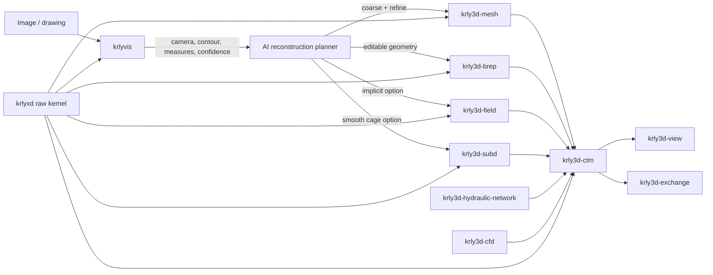
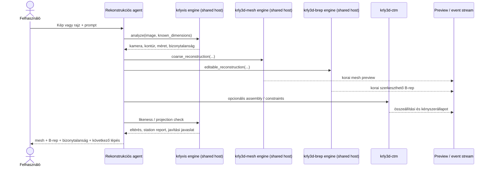
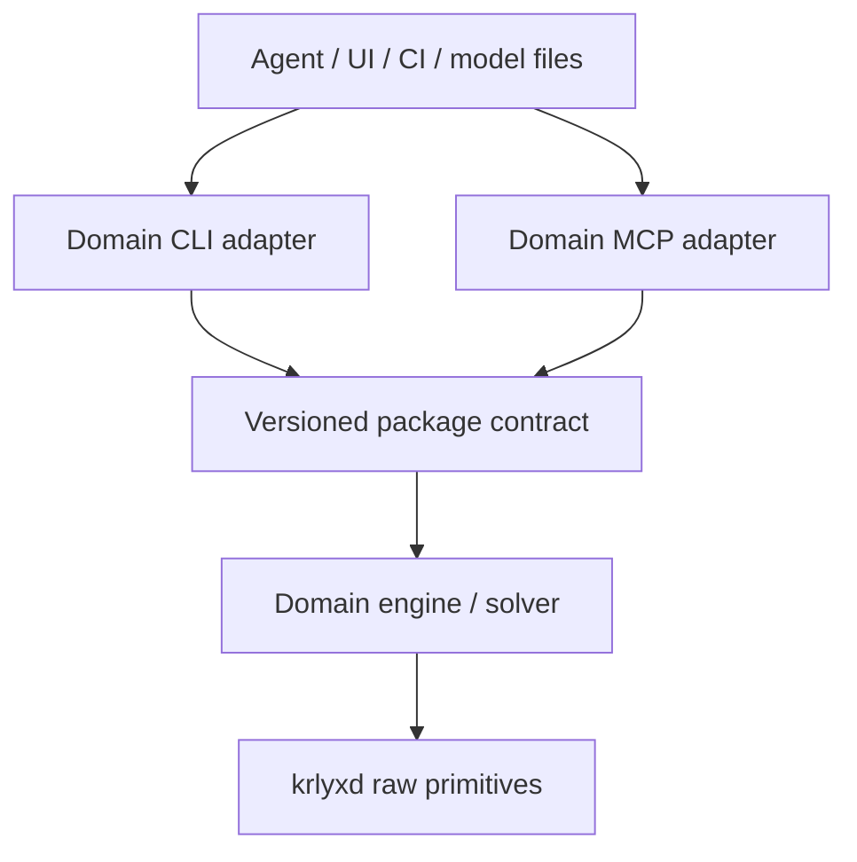
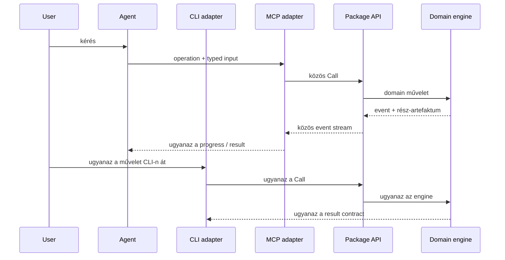

# Termék- és architektúra-átadó

Ez a fájl a termékirányt és az elfogadott architektúrát rögzíti. A gyökérszintű `HANDOFF.md`, a `SPEC.md` és a [`package/krlyvis/SPEC.md`](../package/krlyvis/SPEC.md) írja le a jelenlegi kódállapotot. Az itt vázolt külön `krly3d-*` csomaghatárok és a `krly3d-ctm` célállapotok; a jelenlegi Cargo workspace még nem ebben a formában áll.

## Felhasználói cél

Egy gyors, streamelt, AI-val együttműködő 3D-rendszer építése. A központi munkafolyamatban a felhasználó betesz egy képet, és a rendszer gyorsan adjon belőle használható mesh-t és szerkeszthető B-rep/CAD-testet. A doméneszközök agentekből, CLI-n és MCP-n át együtt használhatók legyenek. A teljesítmény és a kiszámítható, ellenőrizhető eredmény alapkövetelmény.

## Elfogadott architektúra

- `krlyxd` a közös, nyers kernel: közös matematika, alaptípusok és infrastruktúra. Ne tartalmazzon B-rep- vagy más doménspecifikus üzleti logikát.
- `krly2d` külön termék a közös síkgeometriához: nyitott/zárt utak, analitikus görbeleírások, külső kontúr és lyukak, explicit egységek. A raszteres vision és a későbbi vektorimport ezt adhatja a B-rep és más fogyasztók felé. Első natív API és integráció: [ADR 0012](decisions/0012-krly2d-planar-domain.md), [krly2d](KRLY2D.md). Az SVG/DWG-import, görbeműveletek és teljes 2D motor további munka.
- A `krly3d` külön doméncsomagokra bomlik. Ilyen terület a B-rep, mesh, field/SDF, SubD, 3D CFD és a hidraulikus hálózat. Minden doméncsomagnak tiszta, verziózott API-szerződése, saját CLI-csomagja és saját MCP-csomagja legyen. A CLI és MCP ugyanazt a nyilvános szerződést használja.
- A helyi alapértelmezett futtatási cél **egy folyamat, több doménmotor, megosztott immutable artifactok**. A host a revíziókat, függőségeket és publikálási eseményeket kezeli; a belső hívások típusos Rust API-k. A CLI/MCP külső adapter, nem kötelező köztes szállítás. Lásd [ADR 0011](decisions/0011-shared-runtime.md) és [az átállási tervet](SHARED-RUNTIME.md).
- A `krly3d-ctm` az összeállítás, geometriai kényszerek és a későbbi szimuláció/„fizikai tér” gazdája. A doméncsomagokat extensionként fogyasztja. A CLI és MCP adapter; ne ezek legyenek a plugin interfészek.
- A hidraulikus hálózattervezés (csövek, csomópontok, nyomás/áramlás) külön domén a 3D CFD-től és a szabadfelszínű folyadékszimulációtól.
- A `krlyvis` külön termék marad, saját csomagmintával, CLI-vel és MCP-vel. A geometriai termékkel együttműködve támogatja a képből/dokumentált rajzból történő rekonstrukciót. Egy agent több MCP-t is használhat kooperatívan.
- Az AI-támogatás és a PMI rendszerszintű legyen, ne egyetlen opcionális csomag funkciója. Gondolni kell a jegyzetekre, javaslati rétegekre, előzményekre, megfigyelésekre, név szerinti horgonyokra és PMI-adatokra.
- A CUE-t takarékosan kell használni: ne legyen külön CUE-fájl minden művelethez vagy tesztesethez. Csak általános egység-/archetípus-szabályokhoz használjuk, ahol valóban segít. A Rust kód és tesztek kövessék az adott egység természetes Rust-mintáját.

## Studio alkalmazás — 2026-11-14

A mai 3D kipróbálás külön alkalmazáskompozíciót kapott:
[Studio](../products/krly3d/studio/README.md), [ADR 0013](decisions/0013-studio-application-boundary.md).
React/TypeScript + Three.js kliens, protobuf/gRPC-Web, Deno/TypeScript szolgáltatás,
kódban definiált LangGraph, szerveroldali LiteLLM és beszédfelismerés. A bal oldali
sötét XY-rácsos munkatér valódi mesh-t jelenít meg, a jobb oldali chat rövid műveleti
összefoglalókat és natív eseményeket mutat. A képdrag/drop a meglévő krlyvis →
kontúr → B-rep → mesh folyamatot fogyasztja. A geometriát továbbra is Rust számítja.

Az építést chatben tapasztalt szakembert követő `expert` döntési lépés előzi meg:
rövid megfigyelés, szükség esetén egy internetes ellenőrzés forrásokkal, lényeges
bizonytalanságnál pedig egyetlen A–D multiselect kérdés. Több pontosítás egymás
után történik, az eredeti kép és beállítások megőrzésével. A válaszokban lenyitható
token- és USD-elszámolás látható, a jelentett/becsült/ismeretlen adatok jelölésével.
Ez nem bővíti a natív képességeket: lekerekítést vagy működő fogprofilt az AI nem
ígérhet a jelenlegi sziluettkihúzó eszköz helyett.

A teljes térbeli Pikachu-kérés külön **field → mesh → STL** pilotot kapott:
[ADR 0014](decisions/0014-field-mesh-print-pilot.md). A field API/motor/CLI
nem függ B-reptől; a nyomtatási előellenőrzés a mesh API-ban, az STL-író külön
exchange-csomagban van. A Studio **Térbeli figura** művelete egy rögzített,
milliméteres paraméteres receptet futtat. Ez valódi térfogati modell, de nem
általános képből karaktergenerálás: a chat ilyen új képességet nem ígérhet.
A hálóvizsgálatok és az STL float32-ellenőrzése nem igazolják a nyomtatófüggő
falvastagságot, támaszokat vagy a fizikai nyomat sikerét.

A Studio B-rep fája első szeletként a natív vázlatot és kihúzást mutatja a bal
alsó sarokban. Az origó a kontúr befoglaló-középpontja, a keret jobbkezes és
Z-felfelé; a sketch az `XY, z=0` síkon készül, a kihúzás `+Z` irányú. Az
XY/XZ/YZ origósíkok kiválaszthatók és láthatók. Az aktuális művelet nem használ
eltolási segédsíkot, ezért ilyen nincs kitalálva. A vázlat kontúrja a valódi
natív profilhurkokból rajzolódik ki. A profil és a kihúzás most még egy natív
számítási hívásban készül; a külön köztes vázlateredmény, további feature-ök és
field/mesh névvel ellátott látható layerjei még nyitottak. A pixel-art bemenet
őrizze meg a forrás rácsát és palette-jét;
az egy nézetből nem látható mélységet explicit feltételezésként vagy HITL
pontosításként kell kezelni. A jelenlegi native-event → workflow → protobuf út
leveti a lépésrészletek egy részét, a karakter út pedig csak végső mesh-t ad.
A kritikus út, ellenőrzési kapuk és OR-Tools döntés a [0015-ös ADR-ben](decisions/0015-reproducible-construction-timeline.md)
van rögzítve. A B-rep tree megvalósult első szelet, nem teljes replay-funkció.

A szolgáltatás külső CLI-adaptere nem módosítja az egy natív futáson belüli shared
runtime-ot. A Deno/böngésző határon másolatok vannak. A session/artifact tároló
memóriabeli, korlátos és lejár; ez nem tartós dokumentum/replay. A felhasználó ma
kizárta a folyadékot; SVG/DWG és további önálló 2D-fejlesztés későbbi munka.

## Issue-rendezés állapota

Az issue-rendezés befejeződött: a #1–#19 issue-k frissültek, a #20–#25 issue-k létrejöttek.
A 2026-11-14-i elfogadási audit után a [#17 dokumentációs feladat](https://github.com/krlybnd/krlyxd/issues/17)
és a [#19 clean-clone ellenőrzés](https://github.com/krlybnd/krlyxd/issues/19), valamint az ötödik kör után
a [#21 API–CLI–MCP pilot](https://github.com/krlybnd/krlyxd/issues/21) lezárva.
A többi domén átvezetését és a további eseménytípusokat az új
[#26 követőfeladat](https://github.com/krlybnd/krlyxd/issues/26) tartalmazza.
A [#2 disconnect-javítás](https://github.com/krlybnd/krlyxd/issues/2) is lezárva; a legacy eseménybinding a #26-ban marad. A felhasználó elengedte a konkrét F-35/737/moai regressziókat: #18 elvetve, a módosított elfogadás alapján #1 elkészültként lezárva. A további view API-migráció #26. A raw kernelhatár #20 az ADR 0008 és a közös metadata/quality validáció alapján lezárva. A tartalomalapú mesh-cache #3 és az állomásriport #7 is lezárva. **18 issue nyitott, 9 lezárt**. A külön krly2d terméket a [#27](https://github.com/krlybnd/krlyxd/issues/27) követi; a natív sheet-részfeladat elkészült, a #24/#26 teljes elfogadása továbbra is nyitott. A módosítások még helyben vannak, commit és push nélkül.

A fejlesztés megkezdődött: a multi-agent körök eredményeit és a következő feladatokat a
[fejlesztési állapotnapló](DEVELOPMENT-STATUS.md) tartalmazza. A megvalósult kernel/API-pilot
alapja a [0001-es architektúradöntés](decisions/0001-kernel-and-domain-contract.md).

## Reprezentációk és termékcsomagok

A reprezentációk eltérő feladatokat oldanak meg. Ne egy közös adatmodellbe erőltessük őket, hanem adjunk köztük explicit, minőségjelzett konverziókat.

A jelenlegi `Shape` a krly3d geometriai tartományának absztrakciója: nem a nyers `krlyxd`
megosztott primitívje, és nem kötelező univerzális reprezentáció minden doméncsomag számára.
A domének megtarthatják natív típusaikat; az együttműködés explicit konverziókon keresztül történik
([Shape port](../crates/kernel/src/ports/shape/mod.rs)).

- **B-rep / krly3d-brep**: pontos CAD-határgeometria, felületek, élek, héjak, testek, boolean, metszet, offset, shell/thicken, STEP/PMI-kapcsolat.
- **Mesh / krly3d-mesh**: háromszög- és poligonhálók, gyors megjelenítés, rekonstrukció, mesh-műveletek, glTF/OBJ/STL. A termék neve mesh, nem mesh-game.
- **Field / krly3d-field**: implicit alakzatok, SDF, blend/offset, sphere tracing, dual contouring, sculpting.
- **SubD / krly3d-subd**: kontrollhálóból sima felület, subdivision, LOD és szükség szerint UV/LSCM, normálok, anyagok, baking.
- **Hidraulikus hálózat / krly3d-hydraulic-network**: csövek, csomópontok, szelepek, szivattyúk, topológia és hálózati nyomás/áramlás.
- **CFD / krly3d-cfd**: 3D kontinuum-szimuláció, MAC grid, advekció, nyomásprojekció, level set és szabadfelszín.
- **View / krly3d-view**: kamera, raszterizálás/renderelés, preview, picking és likeness-vizualizáció.
- **Exchange / krly3d-exchange**: import/export formátumok és konverziók.
- **krly2d**: külön síkgeometriai domén, formátumfüggetlen profilokkal. A raszterfelismerés a krlyvis, a formátumolvasás a megfelelő exchange adapter, a 3D testépítés a B-rep felelőssége.
- **krlyvis**: külön vision termék; fényképek, rajzok, kamera, kontúrok, nézetek, mérés és rekonstrukciós bizonytalanság.
- **krly3d-ctm**: assembly, kényszerek és a későbbi szimulációs/„fizikai tér” host.

Point cloud, voxel és volumetrikus adatok hasznos jelöltek lehetnek szkenneléshez vagy szimulációhoz, de külön csomaggá csak konkrét use case és saját, tiszta szerződés esetén váljanak. Ezek nem kerülnek a nyers kernelbe.

### A kép–3D átalakítás streamelt menete

Egyetlen képből a rejtett felületek és valós méretek általában nem egyértelműek. Az agent tegye láthatóvá a feltételezéseket és a confidence értéket; ha kell, kérjen további nézetet vagy ismert méretet. Ne várjon a teljes exact feldolgozás végéig: előbb coarse mesh-t, majd szerkeszthető B-rep-et, aztán finomítást küldjön.

## Rust workspace célstruktúra

Az alábbi fa célkép. Nem állítja, hogy a mostani Cargo workspace már így néz ki. A gyökér egy Cargo workspace-ben tartja a buildelt crate-eket; a doméncsomagok külön könyvtárcsaládként rendeződnek. A krlyxd kicsi, doménfüggetlen alap marad.

    krly/
    ├── Cargo.toml
    ├── Cargo.lock
    ├── AGENTS.md
    ├── docs/
    │   ├── architecture.md
    │   ├── contracts.md
    │   ├── decisions/
    │   └── diagrams/
    ├── config/
    │   └── cue/
    │       ├── unit.cue
    │       └── package.cue
    ├── crates/
    │   └── krlyxd/
    │       ├── Cargo.toml
    │       ├── src/
    │       │   ├── lib.rs
    │       │   ├── id.rs
    │       │   ├── error.rs
    │       │   ├── units.rs
    │       │   ├── math/
    │       │   ├── tolerance.rs
    │       │   ├── clock.rs
    │       │   └── contract/
    │       └── tests/
    │           └── public_api.rs
    ├── products/
    │   ├── krly2d/
    │   │   ├── api/           # első natív Path/Segment/Region szerződés
    │   │   ├── engine/        # tervezett, a műveletek bevezetésekor
    │   │   ├── cli/           # tervezett külső adapter
    │   │   └── mcp/           # tervezett külső adapter
    │   ├── krly3d/
    │   │   ├── reconstruction/
    │   │   │   ├── runtime/   # alkalmazás-host, revíziók, typed shared artifactok
    │   │   │   ├── host-cli/  # egyfolyamatos belépő
    │   │   │   └── cli/       # átmeneti teljes process/sheet pilot
    │   │   ├── brep/
    │   │   │   ├── api/       # public request/response/events/schema
    │   │   │   ├── engine/    # exact B-rep algorithms
    │   │   │   ├── cli/       # CLI adapter
    │   │   │   ├── mcp/       # MCP adapter
    │   │   │   └── tests/     # contract + end-to-end
    │   │   ├── mesh/
    │   │   │   ├── api/
    │   │   │   ├── engine/
    │   │   │   ├── cli/
    │   │   │   ├── mcp/
    │   │   │   └── tests/
    │   │   ├── field/
    │   │   │   ├── api/
    │   │   │   ├── engine/
    │   │   │   ├── cli/
    │   │   │   ├── mcp/
    │   │   │   └── tests/
    │   │   ├── subd/
    │   │   │   ├── api/
    │   │   │   ├── engine/
    │   │   │   ├── cli/
    │   │   │   ├── mcp/
    │   │   │   └── tests/
    │   │   ├── hydraulic-network/
    │   │   │   ├── api/
    │   │   │   ├── engine/
    │   │   │   ├── cli/
    │   │   │   ├── mcp/
    │   │   │   └── tests/
    │   │   ├── cfd/
    │   │   │   ├── api/
    │   │   │   ├── solver/
    │   │   │   ├── cli/
    │   │   │   ├── mcp/
    │   │   │   └── tests/
    │   │   ├── view/
    │   │   │   ├── api/
    │   │   │   ├── renderer/
    │   │   │   ├── cli/
    │   │   │   └── mcp/
    │   │   ├── exchange/
    │   │   │   ├── api/
    │   │   │   ├── formats/
    │   │   │   ├── cli/
    │   │   │   └── mcp/
    │   │   └── ctm/
    │   │       ├── api/
    │   │       ├── core/
    │   │       ├── extension-host/
    │   │       ├── cli/
    │   │       ├── mcp/
    │   │       └── tests/
    │   └── krlyvis/
    │       ├── api/
    │       ├── engine/
    │       ├── cli/
    │       ├── mcp/
    │       ├── prompts/
    │       └── tests/
    ├── agents/
    │   ├── image-to-3d/
    │   └── prompts/
    ├── schemas/
    │   ├── packages/
    │   └── events/
    ├── models/
    │   ├── inputs/
    │   └── expected/
    └── tests/
        └── product_flows/

A fában az api/engine/cli/mcp elemek lehetnek külön Rust crate-ek, ha a csomag mérete és publikálása ezt indokolja. Kis csomagnál az API és engine lehet egy crate-en belüli modul is; a CLI és MCP adapter maradjon külön telepíthető bináris/csomag. Ne osszuk fel a kódot fájlokra pusztán azért, hogy minden mappa azonos legyen.

## Rétegek és függőségi irány

A függőség befelé mutasson. A krlyxd nem függhet B-rep-től, CTM-től, MCP SDK-tól vagy CLI parser-től. Egy engine ne importálja egy másik domén belső modulját; domének között public API-szerződés vagy CTM extension-regisztráció legyen.

## CLI/MCP/API contract

A csomag API a termékhatár. A CLI és MCP a contract két adaptere, nem két külön terméklogika.

A közös szerződés írja le:
- stabil package ID, verzió és protocol/schema verzió;
- capability-k és műveletek;
- bemeneti és kimeneti típusok, kötelező/alternatív mezők;
- mértékegységek és koordinátarendszer;
- exactness, minőség, bizonytalanság és provenance;
- progress/event streaming, cancellation és hibák;
- artefaktum formátum, verzió és hivatkozás.

Egy request legalább műveletnevet, inputot, contextet és request ID-t tartalmazzon. A hosszú művelet adjon operation ID-t és eseményfolyamot. Az események foglalják magukba a Started, Progress, PartialArtifact, Warning, Completed, Failed és Cancelled állapotokat. A CLI emberbarát parancsszintaxist, az MCP agentbarát tool descriptiont adhat; a szemantika ugyanabból a szerződésből eredjen.

## CTM mint assembly és extension host

```mermaid
flowchart LR
    CTMCLI[CTM CLI] --> HOST[CTM facade / extension host]
    CTMMCP[CTM MCP] --> HOST
    HOST --> ASSEMBLY[Assembly document]
    HOST --> CONSTRAINTS[Geometric constraints]
    HOST --> REGISTRY[Capability registry]
    REGISTRY --> BREPA[krly3d-brep API]
    REGISTRY --> MESHA[krly3d-mesh API]
    REGISTRY --> FIELDA[krly3d-field API]
    REGISTRY --> HYDA[Hydraulic API]
    REGISTRY --> CFDA[CFD API]
    ASSEMBLY --> KERNEL[krlyxd primitives]
    CONSTRAINTS --> KERNEL
```

A CTM fedezze fel a csomagok képességeit, ellenőrizze a kompatibilis API-verziót, és kezelje a csomagok közötti assembly kapcsolatokat, kényszereket és szimulációs adatcserét. A B-rep vagy CFD önállóan is használható a saját CLI/MCP adapterével; CTM akkor kell, ha több domain összeállítása vagy fizikai összekötése szükséges.

**Technikai ajánlás, külön döntési pont:** Rust cdylib ABI-ra ne építsünk stabil extension contractot. Saját, egy binárisba linkelt extensionök használhatnak belső Rust trait-et. Külön telepíthető külső extensionhöz verziózott, nyelvfüggetlen boundary (például WASM/WIT vagy process protocol) biztonságosabb. A választást benchmarkkal és sandbox/verziózási igényekkel kell összevetni.

## AI, PMI, dokumentum és provenance

Az AI ne átláthatatlanul írja felül az alapgeometriát. A dokumentum adatmodellje legyen képes:
- visszajátszható műveleti előzményre;
- külön, elfogadható vagy eldobható proposal rétegre;
- jegyzetekre, expectationökre, watcherekre és változásértesítésekre;
- szemantikus PMI-re (tűrés, datum, felületminőség) és grafikus PMI-elrendezésre;
- stabil, reprezentációfüggetlen horgonyokra;
- minden műveletnél exactness, uncertainty, quality és provenance jelölésre.

A PMI vagy AI-jegyzet ne csak mesh face indexére hivatkozzon, amely újrateszeláláskor változhat. Topológia módosulásakor a horgony követhető, átirányítható vagy bizonytalan státusszal jelölt legyen.

Az agent promptok külön, verziózott agent/product rétegbe kerüljenek. Javasolt szerepek: vision elemző; rekonstrukciós planner; B-rep specialist; mesh specialist; validator/likeness checker. Az API-kulcs titkos konfigurációból érkezzen, ne CLI argumentumban, logban vagy modellfájlban.

## Prompt és agent folyamat

Kép-rekonstrukciónál az agent:
1. fogadja a képet és a felhasználói intentet;
2. a krlyvis MCP-től kérje a kamera-, kontúr-, méret- és confidence adatokat;
3. nevezze meg a hiányzó feltételezéseket; egyetlen kép nem határozza meg a rejtett felületeket és méreteket;
4. indítsa párhuzamosan a mesh coarse previewt és a szerkeszthető B-rep javaslatot;
5. streamelje mindkét rész-eredményt;
6. használja a likeness/projection ellenőrzést a javításra;
7. csak assembly vagy constraint igénynél hívja a CTM MCP-t;
8. adja vissza az eredményt, bizonytalanságot, felhasznált méreteket és további kérdéseket.

A CLI nem kötelező, ha az agent MCP-n hív; a CLI hasznos emberi operátori, scriptelt és CI használathoz. Az MCP minden termékhez nem egy monolitikus server: a felhasználó döntése szerint csomagonként külön MCP legyen.

## Clean code minták és Rust tesztelési rend

Minták:
- **Ports and Adapters** választja el a public API-t az engine-től és adapterektől.
- **Adapter** a CLI és MCP rétegben.
- **Registry / Extension** a CTM képességregiszterében.
- **Strategy** algoritmusválasztásnál, ha tényleg van több implementáció.
- **Facade** a CTM publikus assembly/constraint műveleteihez.
- **Command + replay** dokumentumműveleteknél és reprodukálható rekonstrukciónál.
- **CQRS jellegű szétválasztás** a mutáló műveletek és read/query oldalak között.
- **Event stream / Observer** a progressre, rész-eredményekre és változásértesítésekre.
- **Builder / typed quantities** konfigurálás és fizikai mennyiségek biztonságához.

Rust szokások:
- Unit test a kód mellett, ha belső implementációs részletet vizsgál.
- Integrációs és publikus API teszt az adott crate tests/ mappájában.
- Egy közös contract suite fusson minden API/engine implementációra és CLI/MCP adapterre.
- Végpontok közötti termékflow teszt a workspace tests/ alatt.
- Modellfájlok legyenek replayelhető regressziós inputok.
- CUE ne helyettesítse a Rust viselkedésteszteket; legfeljebb a package manifest és API-description formai validálását adja.

Ne legyen minden szoftveregységhez merev, művelet-specifikus fájlséma. Minden egységnek legyen egy általános mintája, de a felelősségéhez illő belső szerkezettel.

## Teljesítmény- és streaming alapelvek

„A világ leggyorsabb” célját mérhető célokhoz kell kötni: modell, gép, build típus, minőségi küszöb, idő, memória és warm/cold cache állapot legyen rögzítve.

- Először olcsó, használható coarse mesh preview, utána részletesebb mesh és B-rep.
- Folyamat közben képes legyen a rendszer rész-eredményt cserélni vagy finomítani, stabil artifact ID-val.
- Hosszú futás cancel-elhető legyen, backpressure ne engedje felgyűlni a fel nem dolgozott preview-kat.
- Egymástól független vision, B-rep, mesh és validációs lépések futhassanak párhuzamosan.
- Cache key tartalmazza az input tartalmát, tolerance/quality igényt és API/solver verziót.
- Közelítő és exact eredmény ne legyen összekeverhető; a UI és agent kapjon minőségi jelzést.

## CUE maradjon visszafogott

Ne legyen box.cue, boolean.cue vagy invalid-input.cue minden művelethez. Egy központi általános unit/package archetípus és a csomagmetaadatok validációja elég lehet. A CUE ne legyen kódgenerálás vagy viselkedéstesztek kizárólagos forrása. A Rust API, a Rust contract tesztek és a reprodukálható modellek maradjanak a futtatható igazság.

## Jelenlegi implementáció és acceptance-határok

A `.ctx/ctxe` tartalma másik munkasávhoz tartozik; ezt a dokumentációs hullám nem módosíthatja.

- A megosztott claim parser támogatja a `contains`, `meets` és `iou:peer:drawing` alakokat;
  a kernel megítéli őket a [predicate.rs](../crates/kernel/src/predicate.rs) alapján.
  A likeness sampled raster összehasonlítás, nem exact geometriai bizonyíték
  ([likeness.rs](../crates/view/src/likeness.rs)).
- A peer-link támogatja a `--peer`, `--listen` és `send` útvonalat, de hívása szinkron és
  egyenkénti; callback kéréseket busy hibával utasít vissza. Peer hívás `batch`-ben,
  aszinkron továbbítás és cancel-propagation még nincs
  ([peer.rs](../crates/cli/src/peer.rs), [listen.rs](../crates/cli/src/listen.rs)).
- A dokumentumcache csak sikeres node-buildet jegyez meg; a node-build hibák újrapróbálódnak.
  A B-rep mesh sikeres eredménye body `Arc`, context és tolerance szerint cache-elt; a
  determinisztikus triangulációs budget-decline ugyanebben a scope-ban memoizált. Az untyped,
  layout és transient decline-ok újrapróbálódnak. Ez még nem content-hash vagy formálisan
  verziózott cache ([cache.rs](../crates/core/src/document/cache.rs),
  [interpret/mod.rs](../crates/kernel/src/ports/interpret/mod.rs),
  [mesh/mod.rs](../crates/std/src/interpret/mesh/mod.rs)).
- A krlyvis jelenleg stateful `picture`/`outline`/`frame` dokumentumot, `polygons` és
  `sections` lekérdezést, valamint PNG/JPEG/PNM olvasást biztosít. Ez nem jelenti a teljes
  streamelt image→mesh→B-rep folyamat elkészültét ([session.rs](../package/krlyvis/crates/cli/src/session.rs),
  [SPEC.md](../package/krlyvis/SPEC.md)).
- A profilnyelvben az `R cx,cy w,h r` lekerekített téglalap megvalósított; a sugárnak
  pozitívnak és a rövidebb oldal felénél kisebbnek kell lennie
  ([profile.rs](../crates/std/src/tool/profile.rs)).
- A regressziómodellek vizsgálatakor a szkennelt `/tmp` és `/home/krlybnd/krlybnd` fákban
  csak a [pegboard.k3d](../models/pegboard.k3d), [plate-with-hole.k3d](../models/plate-with-hole.k3d)
  és [tesseract.k3d](../models/tesseract.k3d) modellek voltak; F-35, 737 és moai fixture nem
  került elő ebben a keresési körben.

A teljes, korai kép–mesh–B-rep folyamat, a domainenkénti verziózott API és önálló CLI/MCP
adapterek, CTM extension host, field/SubD/CFD/hidraulikus csomagok továbbra is célarchitektúra,
nem jelenlegi implementáció.

A második fejlesztési körben már megjelent a [külön nyers kernel](RAW-KERNEL.md), valamint
a [típusos mesh API és szinkron engine bridge](MESH-API.md). Ez az első domain-pilot;
ekkor az összes domén szerződése, az eseményfolyam és az új CLI/MCP adapterek még hiányoztak.
A harmadik körben a lokális Rust engine már kontrolláltan megszakíthatja a meshelést és a
statisztikai számítást; a wire API 1.0 változatlan. A negyedik körben külön [v2 operation API és runner](MESH-OPERATIONS.md) ad műveletazonosítót,
korlátozott eseménysort és háttérszámítást. Az ötödik körben a külön
[mesh CLI/MCP adapterek](MESH-ADAPTERS.md) is megjelentek: közös modellbetöltés,
kanonikus CLI-események, MCP műveletindítás/eseményolvasás/megszakítás/felszabadítás.
A hatodik kör a régi socketen indított helyi lekérdezések teljes kapcsolatbontására is
átvezeti a megszakítást, a normál write half-close megőrzésével. A render/probe és
képkódolás kooperatív ellenőrzési pontokat kap. A többi domén adapterei, a peer forwarding
és a legacy progress események még hátravannak; a régi válaszformátum változatlan.

## Workspace- és ellenőrzési állapot

A jelenlegi Cargo workspace főbb területei: `crates/core`, `crates/kernel`, `crates/std`,
`crates/cli`, `crates/view`, `crates/exchange`, `package/krlyvis/crates/*`, továbbá az új
`crates/krlyxd`, `products/krly3d/brep/{api,engine}`, `products/krly3d/mesh/{api,engine,cli,mcp}` és `products/krly3d/view/{api,renderer,mesh,cli,mcp}`. A raw seed és a mesh pilot
migrációja elkészült; a többi target csomag még hátravan. A végső integrált ellenőrzés sikerült:
`cargo test --workspace` 1011 teszttel és 1 compile-fail doctesttel (1012 összesen), 0 hibával és 0 kihagyott teszttel; az
`cargo clippy --workspace --all-targets -- -D warnings` figyelmeztetéselnyomás nélkül, valamint
a `cargo fmt --all -- --check` is sikerült. A korábbi, lint-javítások előtti 721 tesztes baseline
történeti adat; az első kör 728, a második 765, a harmadik 783, a negyedik 821 az ötödik 856, a hatodik 883, a hetedik 915 és a nyolcadik 926 (doctesttel együtt) tesztje szintén korábbi eredmény.
A végső önálló futás doctest-szakasza is sikeres. A nyolc rögzített
legacy CLI JSON-RPC válasz változatlan az új buildben. A hivatalos Python MCP SDK-val
négy CLI/MCP geometriai paritáseset és a hiba/határidő/megszakítás életciklus is sikeres.
A tizedik kör szinkron view wire/CLI/MCP integrációját teljes workspace futtatás, hat új view SDK PNG-paritáseset és friss binárisos legacy/mesh kompatibilitásellenőrzés követte. Részletek: [HANDOFF.md](../HANDOFF.md).

## Struktúraváltás és elavult fájlok

A felhasználó 2026-11-14-i kérése szerint a struktúra átállítását a fejlesztés részeként, doménenként kell elvégezni. A mesh már a `products/krly3d/mesh/{api,engine,cli,mcp}` mintában van; a B-rep snapshot API/engine a `products/krly3d/brep/{api,engine}` alatt kap helyet; a legacy csomagok addig aktívak, amíg vannak fogyasztóik.

- A #2 socket/render kompatibilitási javítás a hatodik körben a jelenlegi helyén elkészült; a legacy eseménybinding még nyitott. Költöztetés nem futhat párhuzamosan ugyanazon modul funkciófejlesztésével.
- A #26 migrációban a [B-rep snapshot-határ](decisions/0005-brep-snapshot-boundary.md) kiemeli a natív betöltést és a rögzített geometria tulajdonjogát a mesh engine-ből. A [typed view API/renderer](decisions/0006-typed-view-renderer.md) a rögzített snapshotra épül, közös kamerával és képkódolóval. A [szinkron view wire 1.0 és önálló adapterek](VIEW-ADAPTERS.md) elkészültek; a típusos geometriai konverzió teljes kiváltása, a további scene/pick/likeness lefedés még hátravannak; a standalone view művelet-életciklus a tizenkettedik körben elkészült. A #1 új backendje már a `products/krly3d/view/mesh` csomagba került; a még aktív legacy view facade marad. A döntést az [ADR 0004](decisions/0004-mesh-preview-boundary.md) rögzíti.
- Költöztetési kapu: tiszta domén-API és tulajdonjog, egyetlen algoritmusimplementáció, API/CLI/MCP paritás, frissített Cargo-útvonalak és importok, függőségi határteszt, sikeres workspace teszt/Clippy/fmt. A bridge akkor szűnik meg, ha minden fogyasztó átállt.
- A bizonyítottan kiváltott fájlok a gyökér `.tmp/` mappába kerülnek. A 2026-11-15-i felhasználói kérés szerint ez gitignore alatt van, ezért a verziózható nyilvántartás a [CAD-refaktorálási tervben](plans/optimal-cad/PLAN.md) marad. Az eredeti útvonalat, hash-t, kiváltó anyagot és indokot rögzíteni kell; aktív hivatkozásaikat javítani kell. A helyi félretétel nem Git-mentés, és nem azonos a végleges törléssel.
- A korábbi indítási terv már archiválva; a működő régi kernel, CLI és renderer még nem elavult. Az ADR-ek és tesztbizonyítékok továbbra is szükséges történeti dokumentumok.

A végső törlés a projekt elkészültekor külön takarítási lépés. Aktuális kiosztás: [multi-agent terv](MULTI-AGENT-DEVELOPMENT-PLAN.md).

### Közös alapréteg határa (#20)

Az [ADR 0008](decisions/0008-raw-foundation-contract.md) rögzíti a raw alaptípusokat és
a doménben maradó részeket. A `krlyxd` közös koordinátakonvenciót, validált confidence /
ismeretlen vagy mért bizonytalanságot és minimális producer-/szerződésmetaadatot ad.
A mesh/view ezeket közös validációhoz használja, wire-változás nélkül. Az összetett
quality/provenance rekordok a saját doménjükben maradnak. Az error-függő Accuracy,
frame és NURBS a jelenlegi geometriai support réteg része; nem függőben lévő raw
export. Cargo marad a csomagverzió forrása, egy központi Rust metadata gate ellenőrzi
a publikus descriptorokat. Ehhez nincs szükség külön CUE fájlokra műveletenként.

## Tizenegyedik kör: cache és mérési riport

A [decline-cache](MESH-DECLINE-CACHE.md) teljes támogatott geometria/config/revízió azonosságot használ, korlátos és context-local; ismeretlen geometrián biztonságosan újraszámol. A [likeness állomásriport](LIKENESS-STATIONS.md) forgatott u/v tengelyeket, explicit lépcsőtűrést és provenance-hoz kötött `matches` eredményt ad. A pixelből eredő kontúr subpixel mérési pontosságot nem állít. A valódi krlyvis peer replay 13 hívása sikeres. #3/#7/#20 lezárva; #26-ban továbbra is szükséges az önálló view életciklus és a likeness szerződés migrációja. Az aktív providerek maradnak; nincs új egész fájlos archiválás.

## Tizenkettedik kör: önálló view életciklus

A [view v2 műveleti szerződés](VIEW-OPERATIONS.md) és az [ADR 0009](decisions/0009-view-operations.md) szerint elkészült a korlátos háttérfuttatás, a deadline/cancel és az explicit release. A CLI eseményeket ad, az MCP négy operation toolt kínál; az eredeti szinkron v1 elérhető marad. EOF és I/O-hiba megszakítást kér, a worker a tényleges kilépéséig foglal kapacitást. Blokkolt output és a legacy szinkron hívás továbbra sem megszakítható az input feldolgozásán keresztül. A hat v1 és két v2 CLI/MCP kép-paritáseset, deadline/cancel/release/reuse és valódi EOF-próba sikeres. #26 további scene/paint/pick/likeness, legacy binding és doménmigrációs scope-ja nyitott; az issue-darabszám nem változik.

A tizenkettedik kör végső workspace futása 1012 sikeres tesztet adott, 79 suite-tal; nincs hiba vagy kihagyás. Szigorú Clippy/fmt/diff-check sikeres. A változások helyiek, commit és push nélkül.

## Termékmérföldkő — a tizenharmadik kör iránya

A következő elsődleges cél a kipróbálható rajz → geometriai javaslat → előnézet → összehasonlítás (#24), az ehhez szükséges infrastruktúrával. Az első [síkbeli rajzpilot](../products/krly3d/reconstruction/cli/README.md) valódi domaineket kapcsol össze és korai befoglaló mesht, majd szerkeszthető kontúr-extrúziót ad. Méretarány és vastagság explicit felhasználói bemenet. A krlyvis lyukkitöltését és a rejtett geometria bizonytalanságát közli; a külsőkontúr-riport nem teljes geometriai bizonyítás. A terv rögzíti az integrációt, az indokolt párhuzamosítást, a működő kiváltás utáni archiválást és a rendezett Git-mentési pontok igényét. A pilot még legacy krlyvis/B-rep peer és standalone mesh/view CLI szerződésekre épül; ez történeti process-állapot; a jelenlegi belső shared-host irányt az ADR 0011 írja felül.

## Tizennegyedik kör: a rajzpilot belső kontúrjai

Az opt-in krlyvis `trace-holes` megőrzi a kiválasztott komponens pixellyukait; a pilot ezeket átmenő lyukként extrudálja. A régi `trace` viselkedése megmarad. A nettó kontúrterület × vastagság és az újratöltött mesh térfogata/zártsága külön ellenőrzött; a likeness továbbra is külső állomásriport. 80 célzott Rust-teszt, 4 valódi folyamatpróba (független exact-ray lyukellenőrzéssel), 13 peer-hívás és Clippy/fmt sikeres. A bizonytalan sarokérintkezéseket elutasítjuk; rejtett vagy vak üregek és más komponensek továbbra sem rekonstruálhatók ebből az egy nézetből. #24 tágabb scope-ja nyitott, 17/9 issue, commit/push nélkül.

## Tizenötödik kör: több kijelölt alkatrész egy rajzból

A [sheet runner](../products/krly3d/reconstruction/cli/SHEET.md) egy rajzból 1–16, névvel és pixel-seeddel kijelölt komponenst dolgoz fel, külön vastagsággal, közös méretaránnyal és rajzkoordinátákkal. Alkatrészenként külön szerkeszthető modell, korai mesh, PNG és anyag-/zártságellenőrzés készül; közös atomikus manifest követi az állapotokat. A teljes csomagra közös deadline érvényes. Hiba/megszakítás megőrzi a kész eredményeket; azonos komponens kétszeri kijelölése hibát ad. Ez explicit kiválasztás, nem automatikus felismerés vagy assembly-kényszermegoldás. Az orchestration a meglévő reconstruction CLI-rétegben marad, geometriamásolat és új egész fájlos archiválás nélkül. #24 teljes helyi host/refinement scope-ja továbbra is nyitott.

Ellenőrzés: 14 valós folyamatpróba egyben sikeres (58,036 s), Python fordítás/diagnosztika és diff-check rendben. 17/9 issue; változások helyiek, commit/push nélkül.

## Tizenhatodik kör: B-rep planar domainhatár

A [planar B-rep szerződés](BREP-PLANAR.md) a meglévő `products/krly3d/brep/{api,engine}` mellé önálló CLI/MCP adaptereket ad. A rajzfolyamat tényleges fogyasztóként ezen keresztül készíti a végső profil/extrúzió dokumentumot. Strict schema, stateless új dokumentum, inputkorlátok és külön construction provenance; a meglévő providerek maradnak. A szinkron művelet nem hoz új háttérfuttatási/cancel szerződést. #26 B-rep rollout részfeladata előrelépett; a krlyvis/likeness migráció és #24 tágabb refinement scope-ja nyitott. Döntés: [ADR 0010](decisions/0010-brep-planar-contract.md).

Végső ellenőrzés: 1055 workspace teszt / 87 suite, Clippy/fmt, 14 folyamatpróba és három hivatalos SDK CLI/MCP-paritáseset sikeres. #24/#26 frissítve, 17/9 issue. Nincs commit/push.

## 2026-11-14 — Közös memóriás helyi útvonal

Az [ADR 0011](decisions/0011-shared-runtime.md) a belső process/MCP-kötelezettséget típusos shared-host kompozícióra cseréli. A [runtime és átállási terv](SHARED-RUNTIME.md) külön alkalmazási rétegben tartja a revíziót, függőséget, admissiont és eseménypublikálást. A doménmotorok native immutable artifactokat osztanak meg; a CTM és a raw kernel tulajdonosi határa megmarad.

Az első futtatható helyi szelet: drawing evidence → retained B-rep → mesh. A `krly3d-reconstruct` exportálja a kész artifactokat. Magasság- és tolerancia-változás a megfelelő előzményt újrahasználja; elavult eredmény vagy javaslat nem írhatja felül az újabbat. A sikeres mesh-cache geometriai testenként nyolc toleranciára korlátozott. A belső köztes JSON/k3d round trip megszűnt ezen az útvonalon; nincs általános zero-copy vagy teljes RAM-kvóta állítás.

A teljes korai preview/render/likeness/sheet flow és lifecycle még átvezetendő (#24/#26). A process pilot addig aktív; nem archiválandó. Az AI proposal/watch/PMI (#15), CTM assembly (#22), multiview/section (#5), külső peer async/cancel (#16) saját nyitott elfogadást kapott. Hat érintett ticket átírva, 17 nyitott / 9 lezárt; nincs új teljes lezárás. A legfrissebb ellenőrzés a [fejlesztési naplóban](DEVELOPMENT-STATUS.md).

## Tizennyolcadik kör: natív hétlépcsős egyrajzos folyamat

A [shared-runtime terv](SHARED-RUNTIME.md#hétlépcsős-natív-stream) szerint a
`krly3d-reconstruct --stream` már helyben végzi az evidence → coarse → editable →
render → likeness lépéseket. A coarse esemény flush előtt nem indulhat a kontúrmodell;
a végleges render és riport ugyanazt a retained snapshotot használja. A likeness
mintavett külső szakaszhatár-egyezést közöl, nem teljes topológiai vagy fizikai bizonyítást.
A host közös stop/deadline tokennel védi a lépéseket és a publikálást; a vision és planar
belső számításának megszakítása, a CLI lifecycle és a sheet még további munka.
A termékstruktúra változatlan, új geometriamásolat nincs. Aktív process/sheet fájl
nem kerül archívumba. Az ellenőrzés és a ticketállapot a [fejlesztési naplóban](DEVELOPMENT-STATUS.md).

## Huszadik–huszonegyedik kör: natív sheet és krly2d

A natív `--parts` út egyetlen képdekódolásból, közös határidővel dolgoz fel 1–16
kijelölt részt. Megőrzi a rajzbeli elhelyezést és lyukakat, és egy későbbi hiba
után a már kész eredményeket is. A részletes szerződés és használat a
[shared runtime leírásában](SHARED-RUNTIME.md#natív-többalkatrészes-sheet) található.

A felhasználó által megnevezett külön `krly2d` termék első API-ja és tényleges
raszter → B-rep bekötése elkészült. Az immutable régiót ugyanaz az Arc köti össze
a vision evidence és a kész modell között; a wire planar adapter ugyanazt az
építőt használja. A topológiai műveletek maradnak a meglévő providereknél.
A görbék megőrzése már API-képesség, a görbe B-rep építés és SVG/DWG-import még
nem. Követés: [#27](https://github.com/krlybnd/krlyxd/issues/27), döntés:
[ADR 0012](decisions/0012-krly2d-planar-domain.md). Az aktuális tesztbizonyíték a
[fejlesztési naplóban](DEVELOPMENT-STATUS.md) van. Aktív process/provider út nem
vált elavulttá; új egészfájlos archiválás nem történt.

## Huszonkettedik kör: a natív 3D út megszakítható életciklusa

Mindhárom natív CLI-mód közös `--timeout`, SIGINT/SIGTERM és megszakítható Unix
pipe-kimenet kezelést kapott. Ugyanaz a caller-owned token jut a hash/raszter/
kontúrkeresési és planar topológiai ciklusokba, a mesh/render/likeness lépésekbe és
a publikálásig. A kész képforrások és B-rep snapshotok nem tartják meg ezt a tokent.
A képdekóder, egyes providerműveletek és a fájlrendszer még nem keményen megszakítható;
a bounded scheduler, replay, refinement és fidelity elfogadása nyitott.

Szerződés és korlátok: [shared runtime](SHARED-RUNTIME.md#közös-cli-életciklus),
ellenőrzés és ticketállapot: [fejlesztési napló](DEVELOPMENT-STATUS.md).
A mai scope továbbra is a meglévő rajz → 3D út; SVG/DXF/DWG és további önálló
krly2d-fejlesztés későbbi feladat. A megbeszélt termékhatárok megmaradtak.
