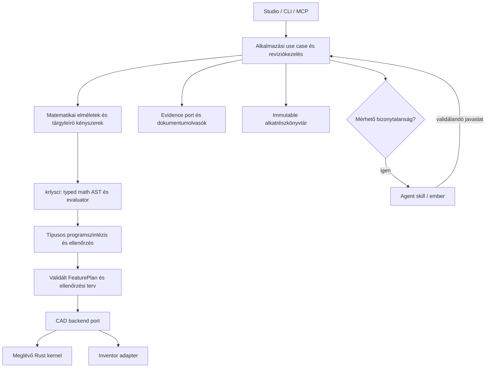

# Matematikával vezérelt CAD és skillalapú agentek

Dátum: 2026-11-15. Állapot: végrehajtható terv, működő típusos CLI/Studio-szelettel; a természetes nyelvű review és az általános cél még nyitott.

Az első párhuzamos végrehajtási kör eredménye: [matematikai szerződés](theory-contract.md) három deklaratív mintával; [review-készültségi audit](review-readiness.md); [D1 parser-kivételi ledger](parser-dedupe-ledger.md) 277 nettó aktív fizikai sor megtakarítással; [Studio DOM-pilot](../../../products/krly3d/studio/ssot/README.md); valamint [két projekt-skill és egy futtatott `.typ` számpélda](../../../cad-knowledge/README.md). A második körben a [D4 runner-limit közösítés](d4-rust-ledger.md) további 27 Rust-sort takarított meg; a [teljes kódmérleg](first-slice-accounting.md) az eredeti baseline-hoz képest 191 sor nettó csökkenést mutat a DOM-pilotot és a regressziós teszteket is beszámítva. A [Studio](d2-studio-ledger.md), [régi process-pilot](d3-reconstruction-ledger.md) és [porting](d5-porting-ledger.md) auditja nem igazolt újabb biztonságos törlést. A parser és DOM-szelet kódban működik, célzott tesztekkel. A `.typ` példa valódi numerikus kiértékelés, nem geometriabizonyítás. A későbbi [típusos review-delta](p0-review-delta.md) már a specifikációt revízióhoz kötötten módosítja, de az általános matematikai szintetizáló és a natív modelljavítás még **nem** működő termékfunkció. A szerződés ezek implementációs és QA-kapuja. A későbbi kódkivételi számokat csak sikeres fogyasztói átállás után könyveljük el.

## 1. Döntési javaslat

Felhasználói pontosítás: **a rendszer alkatrészcsaládoktól független matematikai specifikációt értelmez és ebből szintetizál konstrukciót**. Nincs `Flange` típus, családonkénti planner vagy karimára elágazó futtató. A konkrét tárgy paraméterek, relációk és célfeltételek együttese; neve csak emberi metaadat. A meglévő `krlysci` egyenletfuttatás ennek alapkomponense lehet, de ma nem általános programszintetizáló. Az agent bizonyítékot szerez, segít formalizálni és kezeli a jelzett bizonytalanságot; a formalizált bemenetből a stratégia matematikai kereséssel készül.

A brief minden CAD-alkatrészre vonatkozó optimuma kutatási cél. Az első bizonyítandó állítás: **ugyanaz a típusos geometriai nyelv és kereső több eltérő tárgyleírást kezel új tárgyspecifikus programkód nélkül**. Az induló korlátot a műveleti nyelv, a kényszerek és a keresési keret adja; nem az alkatrészek név szerinti listája. A „hibátlan architektúra” helyett kikényszerített tulajdonosi határok, típusos szerződések és mérhető elfogadási kapuk vállalhatók.

A karima az eredeti brief illusztrációja és legfeljebb egy fixture. Mellé eltérő szerkezetű, tengelyszimmetrikus és aszimmetrikus síkprofilt használó példák kellenek, valamint egy korábban nem látott kompozíció. Új eset felvétele csak specifikációval és ellenőrző adatokkal történhet. Egy kész recept `.typ` fájlba költöztetése önmagában még nem követelményekből történő szintézis.

Új felhasználói prioritás: **marketplace nélkül is hatékony emberi review és pontos, kontextusban értett módosítás**. A rendszer első hasznossági mércéje az, hogy a javításból helyesen módosítja a meglévő partot, megőrzi az érintetlen szándékot, és a már tisztázott döntést nem kérdezi újra. A hibák megelőzéséhez az aktuális követelményeket és korábbi elfogadott javításokat már helyben használja. A későbbi kereshető modellgráf/mesh/RAG és marketplace ezt a képességet bővíti; nem előfeltétele az első működő eredménynek. Marketplace, megosztás és ütemezett automatizmus ebben a szakaszban nem készül.

**Most nem építünk** általános agent-frameworköt, új geometriakernelt, univerzális matematikai nyelvet vagy vektoradatbázist. A szabad szöveges CAD-tervezés megmaradhat külön kísérleti útvonalként, de nem teljesíti a matematikai stratégia követelményét.

## 2. A vizsgálat alapja és korlátai

Átnézett bemenetek:

- [Eredeti brief](/home/krlybnd/Downloads/optimal-cad-modeling-brief.md).
- A következő körben olvasott [szöveges csatolmány](</home/krlybnd/.config/Code/agentSessionData/23719b7b-35f9-4caf-843e-f635e4c5e9eb/attachments/b9ae9d95-ad80-427c-8d72-df04f43518c4/Pasted text #1.txt>) tartalmilag ugyanez, más formázással. A korábbi családsablonos indulást a felhasználó pontosítása felülírta.
- A jelenlegi munkafa; HEAD: `1aac484a594f1e1f7176fd0309d9d5e04f88ae0b`. Sok módosított és még nem követett fájl van. A HEAD önmagában nem reprodukálja a vizsgált állapotot.
- [publication-as-code matematikai publikus API](/home/krlybnd/xrepos/publication-as-code/crates/krlysci/src/lib.rs), [értelmező](/home/krlybnd/xrepos/publication-as-code/crates/krlysci/src/eval.rs), [CLI portok](/home/krlybnd/xrepos/publication-as-code/service/console-api/cli-tool/ports.ts), [Desk proto](/home/krlybnd/xrepos/publication-as-code/ui/proto/krly/v1/desk.proto). A vizsgált könyvtár nem Git-repó; a fontos források hash-e a [futási bizonyítékban](math-probes.json) van.
- [Zeus azonosító-konstansok](/home/krlybnd/orplex/repos/orplex-zeus/ui/webui/console-app/src/core/testIds.ts), [E2E példa](/home/krlybnd/orplex/repos/orplex-zeus/test/e2e/checks/layers.spec.ts), [SSOT irány](/home/krlybnd/orplex/repos/orplex-zeus/.ctx/api-first-ssot.md). HEAD: `d9ad032`; ez nem jelenti a munkafa tisztaságát.
- [Jelenlegi termékhatárok](../../PRODUCT-ARCHITECTURE-HANDOFF.md), [shared runtime](../../SHARED-RUNTIME.md), [feature-history ADR](../../decisions/0015-reproducible-construction-timeline.md), [tool-discovery ADR](../../decisions/0016-cad-tool-discovery-and-verified-workflow.md).

A Zeusban talált példa egy lapos, `as const` objektum; az ellenőrzött E2E-ben még nyers szelektorstringek is vannak. Ez jó kiindulási ötlet, de nem kész, generált és nested DOM-szerződés. A publication-as-code portjai és generált proto-folyama átvehetők koncepcióként; a teljes service-struktúra másolása nem indokolt.

Ez a kör forrásvizsgálatot, a matematikai CLI tényleges fordítását/futtatását, kódkivételt, forrásméret-mérést, célzott Studio E2E-t és sikeres teljes Rust workspace-tesztfutást tartalmaz. Teljes natív CAD/E2E útvonalat és Inventort nem próbáltunk ki; a korábbi fejlesztési naplók tesztszámai történeti adatok.

## 3. A brief matematikai pontosításai

### 3.0 Általános elméleti alap: specifikációból konstrukció

A probléma típusos, kényszervezérelt programszintézis. A nyelv műveleteket és azok jelentését rögzíti; a bemenet azt írja le, minek kell teljesülnie. Ez a syntax-guided synthesis általános felállásával rokon, CAD-specifikus geometriai szemantikával és ellenőrzőkkel. Egy kész SyGuS solver nem kap ettől automatikusan robusztus B-rep szemantikát. [SyGuS formális bemeneti nyelv](https://arxiv.org/abs/1405.5590).

Javasolt problémaobjektum: `S = (Γ, Σ, D, C, E, J, B)`:

- `Γ`: mennyiségtípusok, egységek, koordinátarendszerek és érvényes referenciák;
- `Σ`: rendelkezésre álló geometriai műveletek és kompozíciós szabályok;
- `D`: a megengedett paramétertartomány;
- `C`: geometriai és szerkeszthetőségi követelmények;
- `E`: megfigyelések, célgeometria vagy forrásbizonyíték;
- `J`: a modellezési program költsége;
- `B`: számítási keret, nem matematikai helyességi feltétel.

Az ideális feladat:

```text
p* ∈ argmin[p ∈ L(Σ)] J(p)
subject to Γ ⊢ p : D → Solid
           ∀θ ∈ D : C(θ, p, [[p]](θ), E)
```

`p` a paraméterezett modellezési program; `[[p]]` a geometriai jelentése. Egyetlen alakillesztésnél `D` egyelemű is lehet. A szerkeszthető modellhez több paraméterértéknél vagy bizonyított tartományban is megőrzendők a kívánt relációk. Véges mintateszt csak `tested`, nem a fenti univerzális állítás bizonyítása. A célprogram nyelve és a költség közösen rögzítendő: ha egy tetszőleges importált testet egységköltségű primitívnek engedünk, a feature-szám optimuma kijátszható.

Az elméleti modulok tárgynevek nélkül:

1. **Mennyiségek és típusok:** hossz, szög, pont, irány, profil, test; revízióhoz kötött él/felület. Az érték létezését és műveleti előfeltételét külön igazoljuk.
2. **Geometriai algebra:** transzformáció, extrúzió, forgatás, sweep és regularizált halmazműveletek a backend tényleges supportja szerint. Nincs követelmény minden primitív azonnali támogatására.
3. **Relációk:** egytengelyűség, párhuzamosság, érintés, távolság, illeszkedés, anyagvastagság; előfeltételekkel és toleranciapolitikával.
4. **Szimmetria és ismétlődés:** csoporthatás a geometrián. A `Pattern(H,A) = union[h ∈ H] h(A)` véges `H` esetén általános mintázat; körbeli és lineáris elrendezés külön transzformációhalmaz ugyanahhoz a művelethez. Egy alaptestből kivont ilyen halmaz ismétlődő üregeket ad. A szerkeszthető feature-fa ezt szemantikus patternként őrzi, nem csak kilapított testként.
5. **Előfeltételes átírás:** `guard ⇒ [[lhs]] = [[rhs]]`, egységekkel, topológiával és referencia-megőrzéssel. A szabályt nem a tárgy neve aktiválja.
6. **Keresés és választás:** a megengedett kifejezések közül keresünk, a hibás típusokat és bizonyítottan lehetetlen ágakat korán elhagyva. A sikerhez megfelelő verifikáció és költségmodell kell.

Példa az alkatrésznév nélküli leírásra: adott vastagságú test; közös tengelyű hengeres határok; egy kivonandó alak véges forgatáscsoport szerinti ismétlődése; minimális távolságok; kijelölt méretek módosításakor megőrzendő relációk. Ez az adott feladat adata. A forgatáscsoport, a kivonás és a távolság fogalma az újrahasznosítható elmélet.

**Leírás, végrehajtás és felfedezés külön képesség.** Egy kifejezés kiszámítása nem jelenti azt, hogy a motor képes azt önállóan kitalálni. Elsőként a specifikáció és a generált terv megkülönböztetését kell igazolni, majd kis, tárgyfüggetlen műveleti nyelven a szintézist.

Javasolt keresési ciklus: követelmények → jelöltprogram → ellenőrzés → konkrét ellenpélda vagy diagnosztika → szűkített keresés. Ez CEGIS-szerű megközelítés. Csak megbízható ellenpéldából vagy igazolt szabályból általánosítunk kizárást; egy numerikus kernelhiba nem bizonyítja az összes hasonló konstrukció lehetetlenségét. Ha az ellenőrző nem tud dönteni, az eredmény `unknown`, és a budget lejárta nem `unsatisfiable`. [Programszintézis és CEGIS](https://people.csail.mit.edu/asolar/SynthesisCourse2020/Lecture10.htm).

Az alak önmagában nem határozza meg egyértelműen a jó szerkesztési szándékot. Azonos test mögött eltérő, egyaránt értelmes függőségek lehetnek. A specifikációban külön kell megadni, mi változhat és mi maradjon invariáns; ezt sem az optimumképlet, sem a tárgyfelismerés nem helyettesíti.

A skillek ennek a rendszernek a használatát írják le: formalizálás, követelményhiány felismerése, elméletválasztás és ellenpélda értelmezése. A `.typ` deklarációkat a matematikai futtató értelmezi. Kell általános evaluator/solver és geometriai implementáció, de nincs alkatrészenként kézzel programozott algoritmus. A „bármit” bővíthető reprezentációs célt jelent; nem korlátlan, minden bemenetre gyors és teljes szintézisgaranciát.

### 3.1 A célgeometria és az optimum

Nem minden bemenet ad teljes `G` célgeometriát. Egy fotó, egyetlen nézet vagy néhány katalógusméret csak részleges kényszerrendszert ad. El kell különíteni:

- `ExactTarget`: ismert, normalizált, ellenőrzött célgeometria;
- `ConstraintSpec`: típusos paraméterek, tartományok és relációk; nincs kötelező családazonosító;
- `PartialEvidence`: megfigyelések és hiányzó paraméterek; ebből nincs automatikus megfelelőségi állítás.

Javasolt modell:

```text
P_feasible = { p in P(grammar, capabilityVersion, constraintSpec)
             | typed(p) and requirements(p) and referencesValid(p)
               and verification(p, evidence, tolerancePolicy) = pass }
p_hat = argmin[p in P_evaluated ∩ P_feasible] wᵀ normalize(phi(p))
```

Az eredmény tartalmazza a vizsgált jelöltek számát, a keresés lezárásának okát és az optimum státuszát: `best_observed`, `proven_within_grammar`, `unknown`. Korlátos beam search eredménye nem globális optimum. Az A* garanciához megfelelő állapottér, admissible heurisztika és a költséghez illeszkedő átmenetmodell kell; a 10–15 lépés nem általános teljesítményígéret.

### 3.2 A költség nem geometriai helyesség

A hibás méretet, nem támogatott feature-t és hibás referenciát nem szabad olcsóbb feature-számmal kompenzálni. Ezek hard constraint-ek. A megvalósítható jelöltek költsége lehet:

```text
phi(p) = (featureCount, dependencyDepth, expectedEditCost, measuredRebuildTime)
J_w(p) = Σ w_i phi_i(p)/scale_i,  w_i >= 0, Σ w_i = 1
expectedEditCost(p) = Σ_s Pr(editScenario_s) × cost(rebuildAffectedClosure(p,s))
```

A skálák, súlyok, szerkesztési forgatókönyvek és mérési környezet verziózottak. A választáshoz használt rebuild-idő rögzített profiling snapshotból jön, amelynek hash-e a bemenet része; az éppen futó gép időzítési zaja nem változtathatja meg észrevétlenül a determinisztikus döntést. Friss időmérés új profiljavaslat, nem a régi eredmény átírása. Egy függő feature költségét egy forgatókönyvön belül egyszer számoljuk. Kezdetben a valószínűségek deklarált feltételezések, nem „megtanult” adatok. A szakmai minőséghez megőrzött szándék, névvel ellátott méretek, datumok és szerkesztési próbák is kellenek. A legrövidebb program ezt önmagában nem garantálja; a Kolmogorov-komplexitás helyett a választott nyelvben mérhető leíráshosszt használjuk.

### 3.3 Tolerancia és geometriai ellenőrzés

Egy közös toleranciapolitika kell, de nem egyetlen dimenzió nélküli epsilon minden méréshez. Külön hossz-, szög-, terület-, térfogat- és numerikus tolerancia; abszolút és relatív komponensekkel. A numerikus kernel-tűrés nem gyártási tűrés.

Térfogat, súlypont és tehetetlenségi tenzor csak előszűrő: különböző alakok is osztozhatnak ezeken. Szimmetrikus differenciatérfogat és megfelelő felületi távolság, topológia, furatok és funkcionális méretek együtt vizsgálandók. A mintavett mesh-Hausdorff érték hibakorlát nélkül becslés. A referencia-kernel eltérése vizsgálandó eset, nem automatikus bizonyíték arra, hogy a saját kernel hibás; import, egység, tűrés és meshelés is okozhatja.

A saját kernel birtoklása kontrollt ad, a robusztus booleant és a persistent naminget nem teszi automatikusan megoldottá. A [STEP writer](../../../crates/exchange/src/step.rs) már létezik; az átnézett exchange csomagban STEP importer nem látható. Az exporter támogatott geometriája és a külső visszaolvasás külön QA-t igényel.

### 3.4 Átírás, gráfok, tanulás

- Szalinski releváns előzmény strukturált CSG-programok egyszerűsítésére. Nem igazolja az általános Inventor feature-fa optimumát. Az `egg` csak megadott, helyes átírásokat alkalmaz; a geometriai ekvivalenciát nem találja ki. [Szalinski](https://arxiv.org/abs/1909.12252), [egg háttér](https://github.com/egraphs-good/egg/blob/main/src/tutorials/_01_background.rs).
- A hat furat → mintázat szabály csak azonos furatokra, szabályos elhelyezésre, megfelelő supporttestre és megőrzött kimeneti referenciákra érvényes. „Fillet mindig a végére” nem általános ekvivalencia. A topológiai mellékhatás és a későbbi referenciák is számítanak.
- A tűrésen belüli közelség általában nem tranzitív. Közel azonos testeket nem lehet korlátlanul egy e-classba összeolvasztani, majd exact ekvivalenciát állítani. Exact átírások és becsült alternatívák külön bizonyítékstátuszt kapnak.
- A DAG-megosztás, teljes függőségi mélység és várható változtatási költség nem egyszerű, összeadódó AST-költség. Elsőként véges jelöltlistát pontozunk; az e-graph extraction későbbi, saját feladat.
- Laman tétele generikus síkbeli bar-joint merevségről szól. Egy általános CAD-vázlat érintő-, szög-, ív- és egybeesési kényszereihez puszta darabszámlálás nem teljes solver. Numerikus rang/szingularitás és redundanciaellenőrzés kell. [Elsődleges kutatási összefoglaló](https://arxiv.org/abs/0801.2404).
- A genus nem általános alsó korlát a cut feature-ök számára: egy pattern vagy többhurkos profil több átmenő nyílást hozhat létre egy feature-ben. Csak rögzített feature-nyelv mellett lehet ilyen korlátot bizonyítani.
- A perceptron frissítés előjele a minimalizálási konvencióhoz illeszkedik, de a nemnegatív projekció, normalizálás, közelítő keresés és nem szeparálható szakértői döntések mellett nem vehető át automatikusan a klasszikus konvergenciatétel. [Collins előadás](https://www.cs.columbia.edu/~mcollins/courses/6998-2012/lectures/lec5.1.pdf).
- Kezdetben nincs önmódosító production policy. Visszajelzés → verziózott tanítópár → offline jelölt súlyok → elkülönített értékelés → új policyverzió. Egy felhasználói válasz nem lesz automatikusan új, globális átírási szabály. Az ismeretlen eset ismét előfordulhat, ha a kontextus változott.

### 3.5 Emberi review mint inkrementális matematikai javítás

Az emberi review a specifikáció folytatása. A bemenete az aktuális modell és revízió, a kijelölt geometria/feature/rajzrészlet, az eddigi követelmények és a javítás szövege. A „ez legyen vastagabb” értelmezésekor a rendszernek ismernie kell az „ez” célját, az aktuális méretet, a hozzá kötött relációkat és a korábbi döntéseket. Puszta beszélgetési előzmény vagy mesh nem elegendő: explicit kapcsolat kell rajzi evidencia → követelmény → paraméter/feature → eredménygeometria között.

Javasolt formalizálás:

```text
u_t + selection_t + modelRevision_t + acceptedIntent_t
    → ΔC_t = (add, replace, retract, preserve, scope)
C_(t+1) = apply(C_t, ΔC_t)

p_(t+1) ∈ argmin_lex[p ∈ feasible(C_(t+1))]
           (unrequestedChange(p,p_t), semanticEditDistance(p,p_t), J(p))
```

Ez saját tervezési javaslat. A természetes nyelv értelmezését az agent végezheti, a módosítási jelöltet az aktuális modellhez kötve. A formalizált javítást a determinisztikus validator/solver hajtja végre. Így az AI a mondat jelentését javasolja; a geometriai stratégiát és érvényességet továbbra is a matematikai rendszer kezeli.

A korábbi értéket megváltoztató utasítás `replace`, nem az ellentmondó régi és új feltétel együttes hozzáadása. Az explicit megőrzendő relációk hard constraint-ek. A kérésből szükségszerűen következő geometriai változás az engedett hatás része; nem minden módosult pont számít nem kért változásnak. A szemantikus változásköltség paramétereket, datumokat, függőségeket és érintett régiókat mér, nem forrásszöveg-diffet. Az első érvényes javítást nem írhatja felül pusztán egy kisebb feature-számú, de más szerkesztési szándékú modell.

Példa: „A kijelölt furatsort vidd beljebb 2 mm-rel, az átmérők és a külső kontúr maradjanak.” A kijelölés adja a hatókört; a transzformáció irányát a datum/korábbi iránymegadás határozza meg. Az átmérő és kontúr megőrzése kötelező; a módosítás után anyaghíd, ütközés és függő feature-ök újraellenőrzendők. Ha a „beljebb” két különböző irányt jelenthet és a kontextus nem dönti el, rövid, célzott irányválasztás kell. Ha a kontextus eldönti, végrehajtás és látható diff történik, nem ismételt megerősítési kör.

A végrehajtás a függőségi DAG érintett részét számolja újra, ahol a backend ezt támogatja; a kész eredmény egészének szükséges invariánsait is ellenőrzi. Globális geometriai művelet nagyobb újraépítést igényelhet. A korábbi elfogadott revízió megmarad, a művelet visszavonható. Elavult kijelölés/revízió nem köthető vissza némán másik élre vagy felületre.

**Megelőzés már az első változatban:** ne vesszen el az explicit méret/egység, a sugár–átmérő jelentés, a sketch síkja, a változó és megőrzendő méret megkülönböztetése, a szimmetria, a kiválasztott feature és a forrás eredete. A korábbi elfogadott követelményeket generálás előtt alkalmazzuk. A költségfüggvény csak a követelményeknek megfelelő jelöltek között választ. A már tisztázott preferencia a saját hatókörében érvényes marad.

**Helyi tapasztalat, marketplace nélkül:** minden ténylegesen elfogadott módosításból verziózott rekord készül: előző specifikáció/terv hash-e, kijelölés és koordinátarendszer, utasítás, formalizált delta, utána-állapot, ellenőrzési eredmény, elfogadás/elutasítás és érvényességi hatókör. Először a saját modell és projekt precedenseit használjuk. A minimális tároló a meglévő helyi artifact-/revíziótár, kapcsolat-ID-kkel; nem új gráfadatbázis vagy RAG-service.

Három külön hatókör szükséges: (1) az adott modell javított követelménye azonnal érvényes; (2) kifejezetten általánosnak jelölt projekt/felhasználói preferencia későbbi feladatokra is alkalmazható; (3) több eseten használható geometriai javítási minta csak ellenőrzött előfeltételekkel ajánlható. Az egyszeri „itt 2 mm-rel” nem lesz minden későbbi modellen 2 mm-es szabály. Ha a felhasználó visszavonja vagy kijavítja, a korábbi rekord superseded állapotot kap. A rendszer által generált, még nem elfogadott jelölt nem tanulási címke.

A tanulás első formája a pontos állapotmegőrzés és az ellenőrzött helyi példák újrahasználata. Ehhez nem szükséges modell-finetuning. Később a hasonló követelmény- és konstrukciógráf adhat kezdőjelöltet vagy keresési sorrendet, de az új bemenetre ismét validálni kell. Kevés adatnál nincs hiteles általános javulási állítás; a hasznot helyi előzmények nélküli és előzményeket használó futásokon mérjük.

**Későbbi modellgráf/mesh/RAG:** stabil azonosítókkal összekapcsolható a rajzi evidencia, specifikáció, parametrikus program, revízió, geometriai artifact, ellenőrzési bizonyíték és javítás. A mesh a geometriakeresés egyik nézete; a szerkesztési szándékot a program és követelmények őrzik. A marketplace majd további hozzáférhető forrásokat ad ugyanilyen rekordokból. Most csak a helyi rekordok eredetét és verzióit őrizzük; nem készítünk előre publikálást, rangsoroló szolgáltatást vagy automatikus megosztást.

## 4. Követelmények és elfogadási feltételek

Az alapértelmezett minőségi politika: **a kéréshez tartozó teljes, kidolgozott eredmény elkészítése, ha ehhez megvan a szükséges információ és képesség, és belefér a futási keretbe**. A „mire kell?” nem kötelező kérdés. A kérésből ismert rendeltetést nem kérdezzük vissza, és kis számítási/tokenmegtakarításért nem hagyunk el elvárt részleteket. Példa: a „fekvenyomó rúd menetekkel” kérésből a modellezési feladat és a menetek igénye ismert; ha a méretek és kapcsolatok is rendelkezésre állnak, indul a kidolgozott modell. Ez termékviselkedési példa, nem új rúdcsalád a kódban.

A „teljes” a kért specifikáció lefedését, helyes részleteket, konzisztens paraméterezést és ellenőrzést jelenti. Nem önkényes extra funkciók számát vagy korlátlan finomítást. A tényleges geometriai menet és a jelképes megjelenítés közül nem választunk csendben egyszerűsítést, ha a kérés kidolgozott geometriát igényel és annak minden feltétele adott. Ismeretlen csatlakozási adatot nem nevezünk bizonyítottnak: előbb a rendelkezésre álló projektadatot és evidenciát használjuk; csak a valóban eredményt befolyásoló, fel nem oldható hiányra kérdezünk rá, konkrétan.

A generált első modellnél a követelményteljesség megelőzi a költségminimalizálást. A `J(p)` a teljes követelményrendszert teljesítő konstrukciók közül választ; egy olcsóbb, hiányos modell nem lehet nyertes. A rendszer a teljesítési kereten belül önállóan dolgozik, apró költségkülönbségekre nem kér engedélyt. Ez nem korlátlan tokenfelhasználás: a meglévő budget, cache és determinisztikus számítás megmarad.

Ha az ügyfél később egyszerűsítést kér, az érvényes követelménymódosítás. A korábbi alapértelmezett részletigényt a megfelelő hatókörben visszavonjuk; a megőrzési szabály nem akadályozhatja a kért egyszerűsítést. Nem kérdezzük meg újra, biztos-e benne pusztán az addigi tokenköltség miatt, és nem védjük a már elkészült részleteket az ügyfél új szándékával szemben. A korábbi munka újrahasználható részei megmaradnak, a költség elszámolása tényszerű.

**REQ-01 – Determinisztikus, tárgyfüggetlen út.** A támogatott nyelven adott specifikációhoz azonos engine-, elmélet-, policy-, seed- és inputhash, valamint determinisztikus munkakeret azonos eredményt ad. A wall-clock timeout csak védőkorlát; lejártakor nem ígérünk azonos keresési végállapotot. Elfogadás: több eltérő specifikáció provider nélkül, nulla tárgyspecifikus futtatókód-módosítással; nulla LLM-hívás a formalizált bemenet utáni keresésben. A futási idő és időbélyeg nem része a determinisztikus tervhashnek.

**REQ-02 – Látható szerkeszthetőség.** A terv névvel ellátott paramétereket, datumokat és valódi feature-függőségeket tartalmaz. Elfogadás: vastagság, furatátmérő, osztókör és furatszám megváltoztatása a támogatott tartományban újraépül; nincsenek néma referenciacserék.

**REQ-03 – Egyetlen matematikai forrás.** A skill `.typ` matematikai forrása egy AST-re elaborálódik; ebből készül számítás és megjelenítés. Elfogadás: egy képlet változtatása a futási hash-t és a riportot együtt változtatja; nincs külön TS/Rust képletmásolat.

**REQ-04 – Gépileg védett végrehajtás.** Hálózati vagy agentkimenet először validált adat. Ismeretlen művelet, mező, verzió, nem véges szám, ciklus, idegen modellreferencia és elavult revízió elutasítandó. Az adat nem végrehajtható shell vagy C# kód.

**REQ-05 – Bizonyítékalapú paraméterek.** Minden külső mérethez termékazonosító, változat, forráshely, eredeti egység, normalizált érték, dátum és tartalomhash tartozik. Hiány vagy ellentmondás blokkolja a certified/standard címkét. A szintetikus fixture mindig szintetikus marad.

**REQ-06 – Szűk eszkaláció.** `MissingParameter`, `EvidenceConflict`, `UnsupportedCapability`, `AmbiguousChoice`, `NoFeasibleCandidate`, `BudgetExceeded`, `StaleReference` típusok, konkrét kérdéssel és érintett mezőkkel. Nem minden figyelmeztetés kérdés: előbb a rendelkezésre álló kontextus és bizonyíték oldja fel; azonos követelményeket teljesítő, érdemben egyenértékű tervek között a determinisztikus választás elég. Csak a helyes eredményt érintő, fel nem oldható döntést kérdezzük meg. Az AI válasza javaslat, ismét átmegy a determinisztikus kapukon. Infrastructure hibára nincs fizetős geometriai javítási ciklus.

**REQ-07 – Valós ellenőrzési státusz.** `pass | fail | unknown | not_applicable`, ellenőrzésenként mérés, küszöb, egység és módszer. „Nem futott” nem `pass`; zárt mesh nem design-intent bizonyíték. A kötelező `unknown` blokkolja a könyvtári kiadást.

**REQ-08 – Reprodukálható alkatrészkönyvtár.** Elfogadott terv, csomaglock, evidence, geometria, mérési riport és engineazonosító immutable bundle-ben. Új változat új bundle; ugyanazon idempotenciakulcs nem hoz duplikált kiadást.

**REQ-09 – Inventor feature-export.** Native `.ipt` feature-fa külön adapterben, verziózott támogatási listával. Elfogadás Windows+Inventor gépen: mentés, újranyitás, paraméterváltoztatás és újraépítés. A STEP megnyitása önmagában nem ezt teljesíti.

**REQ-10 – DOM-szerződés.** `domIds`, `data-domid`, nested és dinamikus, típusos hivatkozások. Elfogadás: elírt DOM-név fordítási hiba; téves szülő és duplikált instance E2E hiba; locale-váltás nem töri a célzást.

**REQ-11 – Korlátos végrehajtás.** Közös deadline/cancel, jelölt- és méretkorlát, stale-result védelem. A P0 mérés rögzíti a hardvert, cold/warm és kernelidőt; gyorsaságot csak ezután vállalunk. Nincs LLM-kör feature-önként.

**REQ-12 – Kimutatható egyszerűsítés.** Minden kiváltott modulhoz fogyasztói átállás, visszaállítás és előtte/utána mérés. Production, teszt, generált kód, dokumentáció és helyi archívum külön mérendő. A másik repóba áthelyezett kód nem megszüntetett kód.

**REQ-13 – Kontextusban értett emberi javítás.** A review a kijelölt modellre/revízióra és elfogadott követelményekre hivatkozik; típusos követelménydeltát eredményez. Elfogadás: az egyértelmű javítás elsőre a megfelelő célt módosítja; az érintetlen követelmények teljesülnek; az eredmény diffje látszik és visszavonható. Ha nem áll rendelkezésre megfelelő referenciakörnyezet, a rendszer pontosan azt tisztázza, nem kezdi újra az egész feladatfelvételt.

**REQ-14 – Helyi tapasztalat megőrzése.** Az elfogadott és elutasított javítás külön rekord, hatókörrel és felülírási kapcsolattal. Elfogadás: újranyitás után a rendszer ismeri az aktuális döntést; azonos helyzetben nem ismétli a már megoldott kérdést; más modellen nem alkalmaz példányhoz kötött utasítást globális szabályként. Az újabb explicit kérés felülírja a régi preferenciát a megadott hatókörben.

**REQ-15 – Marketplace nélküli használhatóság.** Modellépítés, review, javítás, undo/replay és helyi előzményhasználat távoli modellkatalógus nélkül működik. A már formalizált feladathoz nem kell provider; a természetes nyelv értelmezéséhez használt provider ettől külön függőség. A távoli keresés későbbi bővítés, nem a helyi működés feltétele.

**REQ-16 – Mérhető javulás.** A review helyessége, az ismételt javítások száma, a nem kért változtatások, a helyi előzményhasználat haszna és az idő/költség mérendő. Új keresési vagy preferenciapolicy csak rögzített regressziós és visszatartott esetsoron igazolt eredménnyel léphet előre; az elfogadott példák számának növekedése önmagában nem minőségbizonyíték.

**REQ-17 – Kidolgozott alapértelmezés, szabad egyszerűsítés.** Teljes bemenet és támogatott műveletek esetén nincs általános célkérdés vagy indokolatlan részletelhagyás. A felhasználó utólagos egyszerűsítése módosítja a követelményeket; az addigi tokenköltség nem akadályozza. Elfogadás: kidolgozott első modell, majd kért egyszerűsítés, mindkét revízió saját követelményeinek ellenőrzésével. A „tökéletes” nem külön, bizonyíték nélküli státusz: a teljesített követelmények és ellenőrzések mutatják a minőséget.

## 5. Célarchitektúra: kevés futtató, tartalomból bővülő tudás



### 5.1 A skill nem új service és nem bizonyítás

Javasolt egy verziózott CAD-tudásplugin, benne néhány feladat szerinti skill. Ez **tervezett projektcsomag**, nem annak állítása, hogy a Studio már tud egy editor pluginját futtatni. A hostfüggő skill-felfedezés adapter; a matek engine providerfüggetlen marad. A csomag minimuma:

```text
cad-knowledge/
  manifest.json              csomagverzió, engine-tartomány, content hash-ek
  skills/formalize-design/SKILL.md
  skills/synthesize-and-verify/SKILL.md
  skills/resolve-evidence/SKILL.md
  skills/explain-failure/SKILL.md
  theories/
    quantities.typ           típusok, dimenziók és egységek
    geometry.typ             műveletek, jelentésük, előfeltételek
    symmetry.typ             transzformációk és csoporthatások
    constraints.typ          relációk és ellenőrzési kötelezettségek
    rewrites.typ             előfeltételes ekvivalenciák
    objective.typ            költség és szerkesztési forgatókönyvek
  cases/                     különböző tárgyak specifikációi és oracle adatai
  publication.typ            megjelenítés ugyanabból a matematikai AST-ből
  sources.lock               pontos forrásverziók és hash-ek
```

A konkrét manifesztet a `krlysci` meglévő csomagolásához kell illeszteni; új package manager nem cél. A `.typ` kiterjesztés önmagában nem garancia a futtathatóságra: csak a verziózott nyelvi részhalmaz elfogadott. Az elmélet- és kényszerdeklarációk formája P0 specifikáció, ma még nincs kész hozzá CAD-predikátum- és szintézis-API.

Első tényleges csíra: [formalize-design](../../../cad-knowledge/skills/formalize-design/SKILL.md) és [synthesize-and-verify](../../../cad-knowledge/skills/synthesize-and-verify/SKILL.md) projekt-lokális workflow-leírások, valamint [planning-quantities.typ](../../../cad-knowledge/theories/planning-quantities.typ) a meglevő `krlysci` numerikus futtatón végigfuttatva. A [run record](../../../cad-knowledge/cases/planning-quantities.run.json) rögzíti a bináris/input hashét és kimenetét. Ezek a fájlok még nem automatikusan felfedezett host-plugin és nem CAD-szintézis: a jelenlegi evaluator nem ellenőrzi az egységeket vagy a geometriát. A további elméletfájlok csak akkor kerülnek be, ha a futtató tényleg értelmezi őket.

A skillleírás mondja meg, mikor alkalmazható az elmélet, milyen adat hiányozhat, mely futtatót hívja, milyen státusznál kér segítséget és hogyan közli a korlátot. Nem másolja a műveletsémát, nem számolja fejben a furatközéppontokat, és nem ír külön engine-t. Új tárgy csak specifikációváltozás, ha a szükséges matematikai/geometriai műveletek és relációk már kifejezhetők. Új solver/primitív egyszeri, tárgyfüggetlen engine-bővítés. A futtató csak csomaggyökéren belüli, lockolt importokat olvas, nincs a matematikai forrásból indítható shell/hálózat; a dokumentum mérete, importmélysége, AST-mérete és futási ideje korlátos.

Alapértelmezésként egy koordináló agent elég; adatbeszerző és magyarázó skilleket tölt be igény szerint. Nem kell állandó matematikus/planner/reviewer agentsereg. A közönséges modellfutás a futtató program munkája; az agent a hiányt és a kivételt kezeli. Az agent által szerkesztett csomag jelölt verzió, nem azonnal trusted production tudás.

### 5.2 Felelősségek és SOLID

- **Domain:** `DesignSpec`, `Theory`, `FeaturePlan`, `VerificationReport`, `ModelRevision`. Nem importál Deno-t, Reactet, Protobuf runtime-ot vagy LLM klienst. Nincs alkatrészcsalád-enum vagy tárgynév szerinti dispatch.
- **Application:** sorrend, megszakítás, jelöltválasztás, publikálás, eszkaláció. A matematikát és geometriát nem implementálja újra.
- **Portok:** keskeny `EquationEvaluator`, `CadBackend`, `EvidenceReader`, `PartLibrary`, `EscalationResolver`. Csak a valódi változási pontok kapnak interfészt; nincs osztályhierarchia minden adat köré.
- **Adapterek:** meglévő Rust kernel, szükség esetén OCCT referencia, Inventor, CLI/MCP/RPC, fájltár. Egy adapter hibáját típusos hibakóddá alakítjuk; a host ne szöveges kernelüzenetek regexéből állapítsa meg a javíthatóságot, mint a jelenlegi [CAD execution adapter](../../../products/krly3d/studio/service/cad-execution.ts).
- **UI:** elfogadott tervet és tényleges végrehajtási eseményt mutat. A feature-metaadatot a végrehajtó állítja elő; nem kell a receptből másodszor rekonstruálni a [jelenlegi presentation builder](../../../products/krly3d/studio/service/native_construction.ts) módjára.

Az interface substitution nem az összes backend azonos képességének állítása: minden backend capability-manifesztet ad. A nem támogatott feature előre hibát ad, nem helyettesítő dobozt. A belső Rust út marad közvetlen típusos hívás; az MCP az agent/külső integráció adaptere, nem kötelező belső hopsor. A jelenlegi domaincsomagokból nem készül új párhuzamos csomagstruktúra pusztán a „SOLID” névért.

### 5.3 SSOT: szerződésenként egy tulajdonos

Nem egy óriási YAML birtokol mindent. Négy külön határ:

1. A kernel Rust operation registry-je birtokolja a tényleges primitívek nevét, paramétereit és supportját. A [Session API](../../../crates/kernel/src/api.rs) már ebből listáz. Bővítendő: eredménytípus, egység, referenciatípus és szemantikai előfeltétel. A mostani egyszerű paraméterséma önmagában nem generál teljes függő típusrendszert.
2. Az elméletek `.typ` forrása birtokolja a deklarált matematikát és költségmodellt; a tárgy specifikációja a paramétereket és követelményeket. A solver ezekből szintetizál tervet. A szemantikus `hole` vagy `pattern` feature nem feltétlenül egyetlen alacsony szintű kernelhívás; a lowering egyszer szerepel a CAD fordítóban. A backend operation registry a tényleges képességet határolja, az elmélet nem hirdethet meg nem valósított primitívet.
3. A meglévő [Studio proto](../../../products/krly3d/studio/protocol/krly/studio/v1/studio.proto) birtokolja az RPC üzenetburkot és eseményeket. A CAD operation DTO-k generáltak a domain-definícióból; ne kézzel legyen másolva az enum proto/TS/Rust között. A migrációs spike választja ki a konkrét generálási utat, és CI drift-check bizonyítja.
4. A DOM-séma birtokolja a UI-szerkezet stabil automatizálási pontjait. Nem az RPC- vagy CAD-séma másolata.

Zod használható a generált TS adathatáron, ha a spike ezt választja. A szemantikai DAG-, unit- és referenciaellenőrzés továbbra is a domén dolga. Nem vezetünk be Zodot csak azért, hogy egy belső `as const` objektum mellé új sémát tartsunk kézzel.

Javasolt `FeaturePlan` adatok: schema/version, theory/package hash, specification hash, parameter vector, canonical units, tolerancePolicy, capability digest, typed nodes, dependency IDs, named datums, output body IDs, required checks, provenance, objective/policy version. `CheckedPlan` csak sikeres validálásból hozható létre; a backend ezt fogadja.

A `FaceRef`/`EdgeRef` modell- és revízióazonosítóhoz kötött, szemantikus eredetű referenciát hordoz. Példa: „baseExtrude felső síkja”, nem „a hetedik face”. Az ellenőrzött wire ID-ből lesz branded TS/Rust handle. A Rust enum önmagában nem igazolja, hogy a futásidőben generált id az adott testben létezik.

### 5.4 A matekfuttató tényleges állapota

A brief „Typst nem számol” állítása ebben a rendszerben nem igaz: a Typstnek is van scripting nyelve, a referenciarepó pedig saját Rust evaluatorral futtatja az annotált egyenletet. [Typst scripting](https://typst.app/docs/reference/scripting/). A cél a már meglevő `.typ` → AST → Rust számítás irány, nem ugyanaz a képlet Typstben, Pythonban és TypeScriptben.

Az offline fordított `krlysci-cli` valódi próbái a [math-probes.json](math-probes.json) fájlban vannak:

- A referencia `cos²(t)+sin²(t)-1` mintája 64 ponton lefutott; a maximális abszolút maradék gépi pontosság nagyságrendű. Ez mintavételi ellenőrzés, nem általános szimbolikus bizonyítás.
- A két jelölt `J=(4+0.5·3+2·0.25, 8+0.5·7+2·0.75)` költségét a forrásból futtatta: `[6,13]`. A jelenlegi nyelv implicit szorzást használ. A kiválasztás, egységkezelés és CAD-validálás ettől még nincs implementálva.
- `r = -1` eredménye jelenleg `holds:true`; a scalar ágon `gap < 1e-9` szerepel, abszolútérték és az állítás fajtájának megkülönböztetése nélkül. Ebből nem lehet egy általános reziduumellenőrzés sikerét levezetni.
- `r = 0 )` exitkódja 0: hibás végződés marad elfogadva. CAD-döntési kapukhoz teljes tokenfogyasztás kell.
- A kipróbált `1 / 2` és explicit `*` nem támogatott. Ez önmagában szintaktikai korlát, nem minden matematikai formára vonatkozó hibabizonyíték. Az MVP-hez osztás, véges skalár, összehasonlítás, pozitív egész darabszám és kiválasztás támogatása szükséges.
- A metaadat `holds` jelölése részben a futás és egy szöveges origin-heurisztika eredménye; nem CAD-geometriai igazolás.

**P0 kapu:** külön `Value`, `PredicateResult`, `ResidualCheck`; egyenlőséghez abszolút/relatív tolerancia, egyenlőtlenséghez explicit reláció. Nincs siker parse-hiba, NaN, végtelen vagy kihagyott feltétel után. Ugyanaz a typed AST szolgálja a riportot és az evaluatort. A krlysci API-t verziózott függőségként használjuk; a helyi abszolút `path` csak spike, nem kiadási forma.

A native Typst `metadata`/`query` hasznos kimeneti adapter, de nem második production evaluator ugyanahhoz a képlethez. [Typst metadata](https://typst.app/docs/reference/introspection/metadata/).

## 6. Illusztratív fixture: matematika és geometria

Az alábbi példa a brief képleteinek ellenőrzésére marad itt. Nem követelmény karimacsalád-modul vagy kézi karimarecept létrehozására. A közös elmélet egy lehetséges bemenete, amely mellett eltérő tárgyak és ismeretlen kompozíciók is kötelező tesztesetek.

Paraméterek: `D,K,d0,dh,b` hossz; `n` pozitív egész, a pilotban legalább 2; `alpha` szög; `m` minimális anyaghíd. Minden hossz kanonikus mm, a szög radián a doménben. Ezek nem konkrét szabványos karimaméretek.

```text
r_i = K/2
theta_i = alpha + 2*pi*i/n, i = 0..n-1
hole_i = (r_i*cos(theta_i), r_i*sin(theta_i))
innerLigament = (K - dh - d0)/2
outerLigament = (D - K - dh)/2
neighborLigament = K*sin(pi/n) - dh
innerLigament >= m; outerLigament >= m; neighborLigament >= m
D,K,d0,dh,b > 0; n ∈ integers; all values finite
V_expected = pi*b*(D² - d0² - n*dh²)/4
```

Az utolsó képlet csak egymást és a központi furatot nem metsző átmenő furatokra, sík, letörés nélküli lemezre érvényes. A chamfer, süllyesztés, agy és tömítőfelület megváltoztatja. Nem nyomástartó szilárdsági megfelelőség. Az `n=1` eset külön ág, nem a szomszédtávolság-képlet behelyettesítése.

Két jelölt, ha a backend mindkettőt támogatja: körgyűrű-vázlat+extrude, illetve félkeresztmetszet+revolve; majd egy furat szemantikus körmintázata. A kernel már tartalmaz [revolve](../../../crates/std/src/tool/revolve.rs) és [pattern](../../../crates/std/src/tool/pattern.rs) műveletet; a Studio [kézi recepttípusa](../../../products/krly3d/studio/service/ai/cad-recipe.ts) szűkebb. A pattern pontos loweringje és a furat életciklusa spike-feladat, nem igazolt azonosság a Studio körfurat-műveletével.

Folyamat: validált paraméterek → szükséges capability-k ellenőrzése → matematikai predikátumok → jelölttervek → végrehajtás → független analitikus/geom. ellenőrzés → determinisztikus pontozás → elfogadott bundle. A költség nem dönthet egy nem ellenőrzött jelölt javára. A kódolatlan „mintázat olcsóbb” szöveges prompt helyett a terv és a pontszám reprodukálható.

## 7. Evidence, adatbeszerzés és alkatrészkönyvtár

Azonosítás: gyártó+part number+család+méretsor+nyomásosztály+altípus+kiadás. DN/PN önmagában nem feltétlenül határoz meg minden geometriát. Források rangsora az adott mezőtől és változattól függ; STEP lehet egyszerűsített, DXF lehet egység nélküli, PDF-tábla félreolvasható. A formátum önmagában nem bizonyítékminőség.

Nem mediánozunk vakon inkompatibilis méretsorokat. `n`, standard/type és cikkszám diszkrét értékek; összetartozó méretvektorokat együtt validálunk. Független mérési zaj esetén indokolt robusztus összevonás; katalógusellentmondásnál `EvidenceConflict`. Azonos eredeti gyártói táblát másoló webshopok nem független szavazatok. Kalibrált adathalmaz nélkül nincs „97% confidence”; van forrásminőség és ismert bizonytalanság.

MVP: egy támogatott forrástípus/gyártói adatsor, archivált jogszerű fixture-rel. Nem egyszerre általános webscraper, OCR, DWG-konverter és STEP-import. Python reader csak ott indokolt, ahol a konkrét dokumentumolvasó ezt igényli; nincs külön Python orchestration a Rust/Deno host mellé. Az olvasó normalizált evidence-recordot ad, nem közvetlen modellezési utasítást.

Az első lépés a meglévő alkatrészkönyvtár és a rendelkezésre álló Inventor Content Center keresése. Ha a pontos változat már létezik és megfelel a szerkeszthetőségi követelményeknek, újrahasználjuk a bizonyítékaival; nem építjük újra csak azért, hogy fusson a generátor. A Content Center összehasonlítási referencia, nem automatikus tanúsítás.

Könyvtári állapot: `draft → verified → released`, vagy `rejected`. A kiadás feltétele a kötelező ellenőrzések sikere és a támogatott export megléte. A cache kulcsa a teljes input+package+engine+tolerance+policy+profiling hash; mértékegység vagy verzióváltás érvénytelenít. Félbemaradt futás nem írja felül a korábbi kiadást.

## 8. Inventor: a feature-fa külön eredmény

Két explicit mód: geometriaátadás STEP-pel és szerkeszthető modell építése az Inventor API-val. A második a brief célja. A közös `FeaturePlan`-t vékony, rögzített C# adapter értelmezi; nem generálunk és futtatunk tetszőleges C#/iLogic forrást minden alkatrészhez. Az Autodesk API a feature-öket és paramétereiket kezeli. [Feature API](https://help.autodesk.com/cloudhelp/2021/ENU/Inventor-API/files/Features_Overview.htm).

A támogatott Inventor-verziót, Windows futtatót és licencek elérhetőségét az integrációs fázis előtt rögzíteni kell. Egy dokumentum műveletei sorosak; tranzakció, rollback, explicit egységkonverzió és exporthiba-státusz kell. A megjelenített egység és az API belső egysége eltérhet; a `UnitsOfMeasure` határon konvertálunk. [Egységmodell](https://help.autodesk.com/cloudhelp/2021/ENU/Inventor-API/files/UOM_Overview.htm).

A `ReferenceKeyManager` dokumentumhoz kötött visszakötést támogat, egyértelmű megoldás esetén; nem általános, minden topológiaváltást túlélő garancia. [ReferenceKeyManager](https://help.autodesk.com/cloudhelp/2027/ENU/Inventor-API/files/ReferenceKeyManager.htm). A szintetizált terv datumjai és feature-eredete az elsődleges referenciák; nem egyértelmű visszakötés blokkoló hiba. QA: `.ipt` mentés, bezárás/újranyitás, méretmódosítás, rebuild, mért geometria és feature-fa összevetése.

## 9. DOM SSOT: `domIds` és valódi nested szerkezet

Az első, szűk slice kanonikus forrása a [domIds.ts](../../../products/krly3d/studio/ssot/domIds.ts): a nested TypeScript objektum kulcsai vezetik le a típusos azonosítókat és attribútumokat. Egy generatorral előállított YAML változat csak akkor indokolt, ha több nyelv/fogyasztó vagy sémamigráció ezt ténylegesen megköveteli. Az alábbi YAML a bővítési **terv**, nem a most telepített generátor:

```yaml
version: 1
attribute: data-domid
nodes:
  studio:
    role: main
    children:
      modelTree:
        role: tree
        children:
          feature:
            repeat: {key: featureId, type: FeatureId}
            children:
              select: {role: treeitem}
              details: {role: group, presence: expanded}
      viewport:
        role: region
        children:
          canvas: {tag: canvas}
```

A kulcsokból készül a stabil pontazonosító; nincs második kézzel karbantartott stringmező. A `repeat` instance kulcs külön attribútum: `data-domkey`, nem listaindex és nem fordított cím. `featureId` az API-ból validált branded típus. A generált selector helper biztonságosan kezeli az attribútumértékeket; nincs kézi CSS-interpoláció.

Tervezett generált használat:

```tsx
// React: a statikus pont és a dinamikus példány együtt, egy forrásból.
const featureDom = domIds.studio.modelTree.feature.key(feature.id);
<div {...featureDom.attrs}>
  <button {...featureDom.select.attrs} role="treeitem" />
</div>
```

```ts
// Playwright: a helper a sémából követi a szülői scope-okat.
const feature = dom(page, domIds.studio.modelTree.feature.key(featureId));
await feature.select().click();
await expect(feature.details()).toBeVisible();
await expect(feature.select()).toHaveAttribute('aria-selected', 'true');
```

A projekt API neve `dom`, `domIds`, illetve szükség esetén `getByDomId`. Belül a Playwright beépített locatorát lehet használni `testIdAttribute: 'data-domid'` konfigurációval; nem kell saját selector engine. [Playwright locators](https://playwright.dev/docs/locators). A dokumentáció nyelvében és a generált projektnevekben nincs `testIds`.

A későbbi YAML-generátor feladata lenne: szigorú YAML-validálás → nested literal TS típusok/konstansok → React attribútumok → szülőre szűkítő Playwright facade → gépi DOM-contract leírás. Zod a generator bemenetének validálására választható; runtime UI-ba nem kell a teljes YAML/Zod parser. A duplikált YAML-kulcs is hiba, mielőtt a parser felülírná. A jelenlegi TS-pilot nem igényel generált másolatot vagy Zod-függőséget; az attribútumokat és a típusos locator-útvonalat ugyanabból az objektumból vezeti le.

`dom(page,node)` minden szintet a kijelölt őshöz szűkít; a stringben szereplő hierarchia önmagában nem DOM-hierarchia. Egy instance scope-ban pontosan egy `select`; a `details` csak expanded állapotban szükséges. Több ablak/modell esetén a studio root is kap instance kulcsot. Portál csak explicit, külön deklarált scope-pal; a feature dependency DAG nem azonos a DOM-fával.

QA: azonos id külön modellekben; listaátrendezés után stabil célzás; hiányzó/duplikált gyerek; rossz szülő; Unicode/idézőjel a későbbi általános repeat-kulcsban; mobile/desktop és HU/EN; role/label/keyboard külön ellenőrzés. Az első pilot a meglévő ASCII `FeatureId` API-validációt használja; a több modell/root, teljes lokalizáció és tetszőleges Unicode instance-kulcs későbbi kapu. A domId nem váltja ki az accessibility tesztet. Egy típusos elemnév még nem bizonyítja, hogy az elem a tényleges DOM-ban létezik.

Az első migrációs szelet a [CadFeatureTree](../../../products/krly3d/studio/web/src/CadFeatureTree.tsx) és az ehhez tartozó egyetlen E2E; a desktop/mobile mock-RPC futás átment. A [scoped locator](../../../products/krly3d/studio/web/tests/dom.ts) a tényleges DOM-ősöket követi, a [build guard](../../../products/krly3d/studio/ssot/check-dom-contract.mjs) a nyers attribútumliteralokat tiltja. Nem generálunk többszáz azonosítót az egész UI-ra, mielőtt ezt validáltuk. YAML-generátor bevezetése esetén CI-kapu még a pinned generátor, determinisztikus kimenet és regeneration diff nulla.

## 10. Kódkivételi leltár és számszerű vállalás

A [source-baseline.json](source-baseline.json) 572 fájl útvonalát, SHA-256 hash-ét, fizikai és nem üres sorszámát tartalmazza. Mérés: követett + nem ignorált új fájlok uniója; `.rs/.ts/.tsx/.py/.css/.proto/.typ`; kizárva `.tmp`, `.ctx`, dependencies/build/bytecode. Ez nem kommentmentes SLOC. Az inline Rust teszt a forrásfájl soraiban marad.

- Összesen **100 764** fizikai sor.
- Forráskategória: **71 024**, külön tesztfájlok: **28 814**, generált: **926**.
- Studio összesen: **20 781**; a többi kategóriával ez nem összeadandó új összeg.
- A vizsgált nyolc Studio implementációs fájl: **4 640** sor.

### D1 – Bizonyított másolat: strict MCP JSON parser

[mesh](../../../.tmp/refactor/d1-parser/products/krly3d/mesh/mcp/src/json.rs): 118; [view](../../../.tmp/refactor/d1-parser/products/krly3d/view/mcp/src/json.rs): 118; [B-rep](../../../.tmp/refactor/d1-parser/products/krly3d/brep/mcp/src/json.rs): 119; [vision](../../../.tmp/refactor/d1-parser/products/krlyvis/mcp/src/json.rs): 119 sor volt. A négy eredeti az ignorált helyi archívumban van, a működő tulajdonos a [közös transport parser](../../../crates/mcp-json/src/lib.rs). Összesen 474 sorból 118 maradt; **356 sor bruttó másolat** tűnt el. A teszt, manifest, lockfile és integrációs határteszt többlettel számolva **277 nettó aktív fizikai sor** a megtakarítás, a [ledger](parser-dedupe-ledger.md) szerinti mérésben.

Feltétel: közös transport/util réteg, a raw matematikai kernel szennyezése nélkül; minden jelenlegi fogyasztó átáll; strict JSON, duplikált kulcs, raw szám, hibakód és üzenetkorlát regressziók megmaradnak. A framing és lifecycle fájlok már eltérnek, nem vonhatók össze puszta hasonlóság alapján. Egy kis közös adaptercsomag csak tényleges nettó megtakarítással indokolt.

A D1 migráció ezt a feltételt az érintett öt crate célzott tesztjeivel, lintjével és friss célkönyvtáras, archívum nélküli checkkel teljesítette. A teljes Rust workspace checkje és tesztje is átment; a Studio natív CAD/E2E útvonala külön kapu marad.

### D2 – Kézi CAD-tudás és szabályok: 4 640 sor vizsgálati felület

- [cad-recipe.ts](../../../products/krly3d/studio/service/ai/cad-recipe.ts): 784; [native_construction.ts](../../../products/krly3d/studio/service/native_construction.ts): 281. Cél: domainből generált szerkezet, egyetlen szemantikai validator/lowering és a végrehajtóból érkező feature-record. A sémagenerálás nem helyettesíti az összes geometriai validációt.
- [expert.ts](../../../products/krly3d/studio/service/ai/expert.ts): 755; [cad-guidance.ts](../../../products/krly3d/studio/service/ai/cad-guidance.ts): 26; [cad-review.ts](../../../products/krly3d/studio/service/ai/cad-review.ts): 235. A támogatott formalizált feladatnál a planner/reviewer prompt helyett matematikai szintézis és ellenőrzés. Az általános beszélgetés és a még nem kiváltott route fogyasztói miatt nem törölhető mindhárom azonnal.
- [workflow.ts](../../../products/krly3d/studio/service/workflow.ts): 823; [native.ts](../../../products/krly3d/studio/service/native.ts): 1 491; [cad-execution.ts](../../../products/krly3d/studio/service/cad-execution.ts): 245. Cél: egy közös specifikáció → szintézis → ellenőrzés use-case, egyszeri tervvégrehajtás és végrehajtói események. Megőrzendő: deadline/cancel, inputkorlátok, folyamatkezelés, artifact-validáció, usage és publikálási védelem.

Ezekben aktív importok és különböző termékutak vannak. **A 4 640 sor nem törlési becslés.** A [Studio modulgráf- és unused auditja](d2-studio-ledger.md) ebben a körben nem igazolt halott kódszeletet. A P1/P2 pilot készít szimbólumszintű remove/retain/generated listát. A korábbi családsablonos megoldáshoz megadott 700–1 500 soros cél nem tekinthető becslésnek az általános szintetizálóra. A generált kód és az új solver/`krlysci`/Inventor kód költségét is jelentjük; lehet kisebb kézi tárgylogika több általános engine-kód mellett. A helyesség elsődleges a sorcsökkentéssel szemben.

### D3 – Régi process-pilot: 611 sor, feltételesen

[drawing_flow.py](../../../products/krly3d/reconstruction/cli/drawing_flow.py): 381; [sheet_flow.py](../../../products/krly3d/reconstruction/cli/sheet_flow.py): 230. A natív shared runtime mellett aktív kompatibilitási út és tesztreferencia. Teljes eltávolítás csak a process-kompatibilitás kivezetése vagy minden fogyasztó átállítása után. A hozzájuk tartozó paritástesztek értékes viselkedési bizonyítékok; nem töröljük őket azért, hogy szebb legyen a sorstatisztika.

A [D3 fogyasztói audit](d3-reconstruction-ledger.md) megerősítette a tényleges importot, subprocess-hívást és a 14 sikeres dedikált process-tesztet; ezen a szeleten a törlés 0 sor.

**Számszerű biztos állítás:** 356 sor azonos parsermásolat + 611 sor feltételes legacy orchestrator = 967 bruttó jelölt, eltérő előfeltételekkel. Nem 967 azonnal törölhető sor, és nem nettó megtakarítás. A Studio nagyobb lehetőség, de előbb egy működő szelet szükséges.

### D4 – Közös runner-limitek

A két aktív mesh/view runnerben azonos, domainsemleges limitkonfiguráció és -ellenőrzés a meglévő `krlyxd` rétegbe került. A publikus importutak megmaradtak; [mért nettó eredmény 27 Rust-sor](d4-rust-ledger.md). Az események, feladatok és lifecycle-kód eltérnek, ezért a teljes runnereket nem olvasztottuk össze.

### D5 – Történeti porting források

A [fájlszintű paritási audit](d5-porting-ledger.md) 0 biztonságosan törölhető Rust-sort igazolt. Például a régi ferde sík–henger ellipszismetszésnek a mai kernelben nincs megfelelője. A `legacy-opengeometry` ág ebben a checkoutban nem elérhető, ezért nem tekinthető visszaállítási forrásnak.

### Megőrzendő alapok

Kernel/provider algoritmusok, saját matematikai numerika, topology, tesztelt mesh/render, cancellation, model/revision, STEP writer, typed domain API és a meglévő proto-generálás. A `package/krlyvis` sem törölhető csak azért, mert új vision API is van: a providerek és az adapterek továbbra is használják. A skillleírás nem vált ki geometriai motort.

### Archiválási és mérési protokoll

1. Változtatás előtt baseline + az érintett eredeti fájlok hash-e; a nem követett fájlokról is külön visszaállítható mentés. Nem hard reset és nem az egész piszkos munkafa egyetlen „refactor” commitja.
2. Kiváltó út átállítása, fogyasztókeresés, viselkedési paritás és szükséges ellenőrzések.
3. Az eredeti helyi fájl `/.tmp/refactor/<batch>/<eredeti-út>` alá mozdul; dokumentált restore-útvonal. A `.tmp/` gitignore alatt van, nem publikált biztonsági mentés.
4. Verziózott ledger az adott batch diffjében: eredeti út, hash, új owner, indok, bizonyíték, archivált út, sorok. Build/test/CI/glob nem függhet `.tmp/`-től. ADR és történeti bizonyíték nem automatikus törlési célpont.
5. Azonos mérési módszerrel új snapshot. `net = baseline_active - after_active`; emellett külön gross_removed, added_handwritten, added_generated, test és docs delta. A HEAD-diff a korábbi változásokat is tartalmazza, ezért önmagában nem ennek a refaktornak a mérlege.

**E két kör ledgerje:** `.tmp/` ignore bekapcsolva; a négy eredeti parser helyi archívuma és visszaállítási leírása a [D1 ledgerben](parser-dedupe-ledger.md), a két runner eredetije a [D4 ledgerben](d4-rust-ledger.md) szerepel. A parser 474 sorából egy 118 soros közös implementáció maradt; a runner-limit közösítése további 27 nettó Rust-sort takarított meg. A teljes mért eredmény az új DOM-forrással és tesztekkel együtt [191 nem ignorált kódsor csökkenés](first-slice-accounting.md). Új általános CAD-szintetizáló framework nem készült.

## 11. Megvalósítási sorrend, kapuk és méretezés

A felhasználói pontosítás az első változat családsablonos fázisbecsléseit érvényteleníti. Az általános szintézishez P0 után lehet munkanapbecslést adni. Az alábbi sorrend kapukat határoz meg; nem kér automatikus subagent-indítást.

**P0 – Elmélet és végrehajtható nyelvrészhalmaz.** A `Γ,Σ,D,C,E,J` pontos szemantikája, specifikáció/terv különválasztása és a krlysci parser/check problémáinak javítása. Ehhez már most hozzátartozik a review-delta, a megőrzési feltételek és a változtatás költsége. Kis, típusos geometriai nyelv; eldönthető kényszerek és numerikus ellenőrzések explicit elhatárolása. Három eltérő geometriájú specifikáció, amelyekben nincs megadva kész műveletsorrend. Kapu: REQ-03/04/07, QA-MATH; tárgynév nélküli azonos evaluator. Ne a tárgyak listáját, hanem a műveletek és kényszerek körét szűkítsük.

**P1 – Korlátos, általános szintézis.** Jelöltkonstrukciók előállítása a közös nyelven, paramétermegoldás, költség és ellenőrzés; meglévő Rust műveletekre lowering. Egy visszatartott, új kompozíció megoldása új core kód és tárgyspecifikus átírás nélkül. Konkrét ellenpéldával történő szűkítés és őszinte `unknown`/budget státusz. Kapu: REQ-01/02/06/11 és QA-GENERALITY. A régi CAD-recept csak a ténylegesen kiváltott képességnél vezethető ki.

Az első [korlátos szintézis-pilot](p1-bounded-synthesis.md) már terv nélküli `.typ` célból két egymást metsző test union tervét állítja elő és a natív kernellel ellenőrzi. Négy korábbi cél is működött kézi terv nélkül. A keresés legfeljebb két testre és hat pozitív hosszparaméterre korlátozott; a paramétereket még nem oldja meg, az optimális tervet nem bizonyítja, és a siker véges próbákon alapul. Ez a P1 kapu részleges eredménye, nem a teljes elfogadása.

**P1 első használhatósági kapuja – Review → helyes javítás.** Még a szélesebb szintéziskeresés bővítése előtt egy meglévő validált modellre paraméter-, reláció- és topológiaváltoztató javítás; megőrzési feltételek, részleges újraépítés, ellenőrzés, helyi elfogadott előzmény és undo. Kapu: REQ-13/14/15 és QA-REVIEW. A helyi előzményrögzítést nem halasztjuk a teljes könyvtárra vagy marketplace-re.

A [keresési pilot](p1-bounded-synthesis.md) már egy skaláris review-delta után, új kézi terv nélkül újraépíti és ellenőrzi a gyűrűt. Ez volt a paraméteres részkapu; a geometriai cél szerkezeti módosítása és az elfogadott állapot kezelése külön lépést igényelt.

A [strukturális review és helyi előzmény szelet](p1-structural-review-history.md) a geometriai cél név szerinti cseréjével gyűrűből tömör hengert épít, az elfogadott revíziókat fájlban megőrzi, és CLI undo/redo/checkout műveleteket ad. A [review-hoz kötött elfogadás](p1-reviewed-acceptance.md) már megköveteli a típusos rekordot és annak egyezését az aktív szülővel. A Studio-kijelölés/diff, részleges újraépítés, természetes nyelvi értelmezés és elutasított javaslatok még nyitottak; a kapu részleges.

**P2 – Studio + nested domIds.** Az első feature-tree DOM-célzási pilot kész. A Studio most a `.typ` alapmodellt és revízióhoz kötött review-t a publication-as-code CLI-n és natív CAD-ellenőrzőn futtatja; helyi elfogadott előzményt, változáslistát, tervet, próbákat, hálót és undo/redo-t mutat. A natív háló hiánya nem rejti el az elfogadott revíziót. A következő kapu a modell/feature/rajzrészlet-kijelölés átadása a review-kérésnek, geometriai előtte/utána diff, valamint a természetes nyelvű javítás típusos deltává alakítása. A jelenlegi Studio-teszt és böngészős próba explicit `.typ` bemenettel fut; általános nyelvi megértést nem bizonyít. YAML-séma/generátor és generated drift-check akkor kerül ide, ha több fogyasztó miatt szükségessé válik. Kapu: REQ-10/13, QA-DOM/QA-E2E/QA-REVIEW. A teljes UI-t csak a bevált minta szerint migráljuk.

**P3 – Evidence + könyvtár.** Egy ellenőrzött forrás/kiadás, mezőszintű provenance, konfliktuskezelés, immutable bundle és replay. Kapu: REQ-05/08. Több webshop/OCR/DWG külön becslés; nem rejtett része ennek a fázisnak.

**P4 – Inventor függőleges szelet.** A közös geometriai nyelv egy rögzített részhalmazának verziózott adaptere; explicit units, named datums, több eltérő terv mentése/újranyitása/edit/rebuild. Nincs tárgyspecifikus C# generálás. Korai technikai spike már P0/P1 közben indokolt lehet az adapter megvalósíthatóságára. Kapu: REQ-09; STEP-preview nem helyettesíti.

**P5 – Kiváltás és kódkivétel.** D1 összevonás az első, D4 kis közösítés a második körben teljesült; D2 kész szeletek kiváltása, D3 csak saját kompatibilitási kapujával, D5 csak állításparitás után. Ledger, tiszta build `.tmp` nélkül, célzott tesztek, összes érintett workspace check. Kapu: REQ-12. Nem várunk e-graphra ahhoz, hogy egy bizonyított másolat eltűnjön.

**Később, külön döntéssel:** gazdagabb geometriai nyelv; szakértői korpusz; offline súlytanulás; bizonyított átírásokkal történő gyorsítás; növekvő keresési keret. Az általános keresés már az alapirány része, kezdetben korlátos nyelven. A tetszőleges szilárdtest→szakértői Inventor-fa szintézis teljes megoldására most nincs hiteles napbecslés.

## 12. QA és követelménykövetés

**QA-DEFAULTS → REQ-06/17.** Teljes információjú, részleteket kérő feladatnál a rendszer nem kérdez általánosan rendeltetést, elkészíti a kért részleteket, és nem helyettesíti őket jelképes modellel pusztán tokenmegtakarításból. A futási kereten belüli olcsó minőségjavításhoz nincs külön engedélykör. Valóban hiányzó, eredményt megváltoztató adatnál egy konkrét kérdés jelenik meg; a válasz után nem kérdezi újra. Egy következő „egyszerűsítsd, ezt a részletet hagyd el” utasítás a megfelelő feltételt lecseréli/visszavonja, a többit megőrzi, és nem hivatkozik az addigi költségre az egyszerűsítés elutasításaként. Több, eltérő tárgyon ugyanazt az általános politikát teszteljük.

**QA-GENERALITY → REQ-01/03/04.** Azonos core+elmélet verzióval forgásszimmetrikus, ismétlődő és aszimmetrikus specifikáció, majd visszatartott új kompozíció. A solver bemenete követelmény, nem kész recept. A tárgyak elnevezéseinek felcserélése változatlan geometriai kényszerek mellett nem módosítja a tervet. Sem név szerinti elágazás, sem fixture-hash szerinti rejtett lookup nem fogadható el. Új specifikációhoz nincs core kódváltozás. Sikertelen keresésnél külön `unsupported`, `unknown`, `budget_exceeded` és csak bizonyíték esetén `unsatisfiable`.

**QA-REVIEW → REQ-13/14/15.** Ugyanazon valós modellen: méretcsere a régi feltétel lecserélésével; kijelölt pattern mozgatása megtartott átmérőkkel; szerkezeti módosítás megőrzött külső kontúrral; „a másik oldalon” stabil referenciával; kétértelmű irány célzott tisztázással; lehetetlen kérés konkrét ütköző feltételekkel. Ellentmondó kérés nem törölhet csendben védett feltételt. Két modell közötti kijelöléskeverés, stale revision, undo/redo, újranyitás és egymás utáni review-k ellenőrzése. Az egyértelmű esetekben nincs felesleges visszakérdezés; a kétértelmű esetben nincs önkényes geometriai találgatás. Mérjük a kért relációk teljesülését és a megőrzendő jellemzőket, nem csak a sikerüzenetet.

**QA-EXPERIENCE → REQ-14/16.** Ugyanaz a visszatartott javítási esetsor helyi előzmény nélkül és előzménnyel; ugyanazon engine/policy/budget. Külön jelentés: elsőre helyes célkijelölés és módosítás aránya; további emberi javítások száma; nem kért szemantikai változások száma; ismételt, már megválaszolt kérdések; késleltetés és providerköltség. A tesztesetek saját válaszai nem szerepelhetnek előre a memóriában; a pontos ismétlés/replay teszt külön kategória. Példányhoz kötött preferencia nem szivárog más projektbe, visszavont döntés nem tér vissza. A kurált, egyértelmű elfogadási eseteken minden előírt és megőrzési feltételnek teljesülnie kell. A szélesebb általánosításra a mérés ad eredményt, nem előre ígért százalék.

**QA-MATH → REQ-03/04/07.** Teljes parse vagy hiba; skalárérték és igazságállítás külön; `-1` nem sikeres nulla-reziduum; dangling token elutasítva; NaN/Inf/division-by-zero; mm/in és deg/rad konverzió; szorzás/osztás dimenziói; nincs bool→number coercion. A képlet és riport ugyanazon AST hash-re mutat. Tulajdonságteszt: forgatás megőrzi a sugarat; hosszskálázásnál térfogat `s³`; furatszám egész és a listahossz ugyanaz.

**QA-GEOMETRY → REQ-01/02/07.** Jó karima, `n=2`, több furat, határhoz közelítő anyaghíd; negatív vastagság, átfedő furat, túl nagy központi furat, tangenciák. Analitikus térfogat, furatközéppont és átmérő külön oracle. Determinisztikus fixture-kezdőmag. A generátor és az oracle nem hívhatja ugyanazt a hibás képlet-helper implementációt az elvárt eredményhez. OCCT összevetésnél normalizált units/tolerance és minimális reprodukáló eset; nem a teljes szélső geometriahalmaz univerzális helyességi igazolása.

**QA-PLAN → REQ-01/02/04.** Kör a DAG-ban, hiányzó input, nem hozzájáruló ág, rossz output kind, másik modell/revízió handle-je, nem támogatott capability. Több egyenértékű jelöltnél stabil tie-break. Kézzel ellenőrzött kis jelölthalmazban a minimumot választja; timeoutnál nem ír `optimal:true`. Átírásnál geometrián túl a paraméterezhetőség és referencia-eredet is megmarad.

**QA-EVIDENCE → REQ-05/06.** Más kiadású táblák, eltérő cikkszám, sugár/átmérő tévesztés, vesszős tizedes, inch/mm, OCR-ben `0/O`, hiányzó cella, másolt források. Konfliktus esetén nincsen automatikus összeátlagolás. A forrás módosulása új hash és új ellenőrzés.

**QA-LIFECYCLE → REQ-04/08/11.** Cancel az eval, build, ellenőrzés és publish alatt; deadline; régi revízió későn végez; újranyitott session; részleges fájlírás; idempotens ismétlés; nincs completed+failed kettős terminális esemény. Az artifacthash csak sikeres validált publikációhoz kapcsolódik.

**QA-AGENT → REQ-01/06.** Támogatott formalizált bemenetnél 0 LLM-hívás a szintézisben. Nem támogatott típusnál konkrét eszkaláció; hiányzó méretet nem talál ki. Manipulatív dokumentumszöveg nem írja felül a csomagot vagy a felhasználói célt. Válasz után újravalidálás; a provider hibája nem kerül a geometriai negatív cache-be. Az AI „elfogadom” nem felülbírálata a mateknak.

**QA-DOM → REQ-10.** Pozitív compile fixture és `@ts-expect-error` hibás névre, rossz kulcstípusra. Runtime nested-scope és cardinality teszt; duplikált kulcs, rossz szülő, átmozgatott feature, collapsed részlet. A contractteszt tényleges DOM-ot ellenőriz, nem a generator saját kimenetét hasonlítja önmagához.

**QA-E2E → REQ-01/02/07/10.** Valós service+natív kernel: méretek megadása → terv → feature-fa → mesh → mérési riport → letöltött artifact. RPC/runId/revision és feature-id egyezés; a modellcsere ténylegesen frissíti a viewportot. Standard fixture offline; egy külön opt-in külső forrás/provider smoke. Nincs `sleep`-alapú siker és nincs csak képernyőképre épülő geometriai bizonyítás.

**QA-INVENTOR → REQ-09.** Támogatott Windows+Inventor verzió; létrehozott feature-típusok és névparaméterek; mm/deg határkonverzió; újranyitás; furatszám/vastagság változtatása; reference bind hiba; rollback; `.ipt` és ellenőrző geometria összevetése. Ez külön futtatókörnyezet, nem Linux mockkal kipipált elfogadás.

**QA-LEAN → REQ-12.** Újramért inventory, import- és Cargo dependency scan, `.tmp` nélkül végzett build, generált drift-check. Megőrzött inputkorlátok/cancellation és releváns regressziók. A domain nem importál transport/UI/provider réteget; nehéz generátort nem kap meg a browser bundle.

Release-feltétel az adott fázis QA-kapuja, nem a tesztdarabszám. A közös nyelvhez több eltérő specifikáció jó végigfutása, a fenti határhibák, módosítási forgatókönyvek és replay szükségesek. A performance baseline median/p95, cold/warm, hardware és inputméret mellett közlendő; mért adat nélkül nincs „baromi gyors” garantált SLA.

## 13. Következő munkacsomag: a szerződés futtathatóvá tétele

P0 megkezdve: a [parser-határ reprodukáló negatív `.typ` esete](p0-parser-boundary.md)
igazolta, hogy a régi krlysci bináris egy fölösleges zárójelet elfogadott.
Az `orplex-kalyx` checkoutban ezt, a negatív reziduum téves sikerét és a
nem véges számok elfogadását célzottan javítottuk. A [P0 típusos `.typ`
szelet](p0-typed-contract.md) a Typst szintaxisfájából már külön
specifikációt és statikusan ellenőrzött jelölt tervet olvas, SI-re váltott
egységekkel és követelményenkénti igaz/hamis eredménnyel. A geometriai
jelentés, a tényleges művelet-végrehajtás és az általános szerződés többi
része még nem teljesült. A párhuzamos TypeScript
matematikai sémakísérletet az ignorált `.tmp/` alá helyeztük, hogy ne nőjön
egy újabb kézzel írt evaluator a `.typ` mellé.

A [P0 review-delta szelet](p0-review-delta.md) már revízióhoz és hashhez
kötött, típusos paraméter- és feltételcserét ellenőriz; két egymás utáni
`.typ` javítás a CLI-n végigment. A tervhash a javítás után érvénytelen, a
`geometry_verified` hamis. Ez még nem változtat natív testen és nem kapcsolódik
a Studio kijelöléséhez.

A [natív mérési szelet](p0-native-measurements.md) már négy eltérő `.typ`
jelölttervet a meglévő kernellel testté épít és külön geometriai próbákkal
tesztel. Review után egy új hashhez kötött gyűrűterv ismét felépült. Ez véges
tesztelés, nem teljes alakbizonyítás; az itt kézzel megadott tervektől külön
létezik a [P1 keresési pilot](p1-bounded-synthesis.md). A Studio
fogyasztói még nem ezen az útvonalon futnak.

1. A [matematikai szerződés](theory-contract.md) első változatának implementálása: a mennyiségi típusok, aritmetika, egyszerű összehasonlítások és a `DesignSpec`/`FeaturePlan` statikus gráfellenőrzése megkezdődött. A review-delta skaláris részhalmaza (`update`, `add`, `replace`, `retract`, `preserve`) működik. Három geometriai próbatípus és a natív tervfuttatás is működik. Következő: teljesebb geometriai célpredikátumok, független alakellenőrzés, strukturális delta és költség gépi reprezentációja. A teljes dokumentált elmélet még nem futtató.
2. Három különböző tárgy deklaratív leírása ugyanabban az elméletben, kézzel ellenőrzött helyességi feltételekkel és tárgyanként konkrét review-forgatókönyvekkel; nincs tárgyspecifikus engine-függvény és nincs előre megadott kész feature-sorrend.
3. A megoldhatósági részhalmaz, az ellenőrzési státuszok, a javítási delta és a keresési keret meghatározása; csak ezután a minimális solver-spike és a szükséges krlysci-javítások. Az első használhatósági bizonyíték a meglévő modell helyes módosítása és az elfogadott döntés helyi megőrzése.
4. A közös terv végrehajtása a meglévő kernellel; a már elkészült `domIds` feature-tree pilothoz revízióhoz kötött kijelölés, review-diff és undo. A pontos hiányokat a [review-készültségi audit](review-readiness.md) sorolja fel. Marketplace és távoli modellkeresés nélkül.
5. A ténylegesen kiváltott részek diffje és nettó kódmérlege. Az általánosság elfogadása QA-GENERALITY alapján, nem egyetlen tárgy sikerén.

Ezzel hamar kiderül, hogy a természetes `.typ` + skill irány valóban csökkenti-e a kézi kódot. Ha a spike csak egy újabb párhuzamos sémát és futtatót termel, a kapu nem teljesült.
